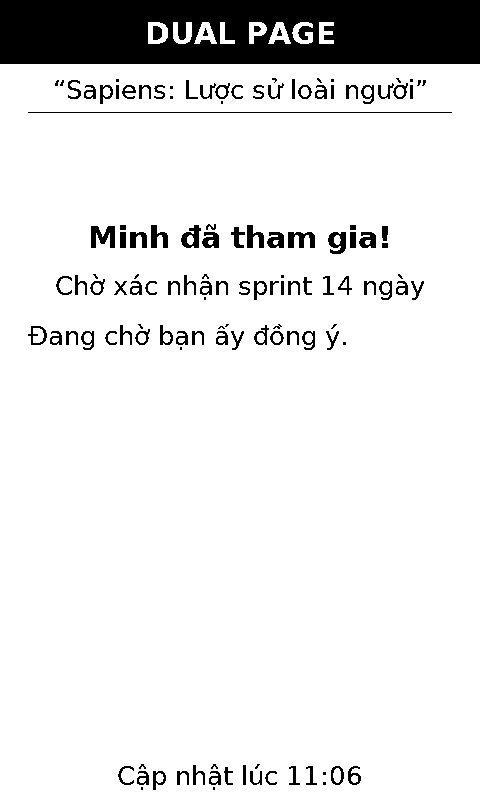
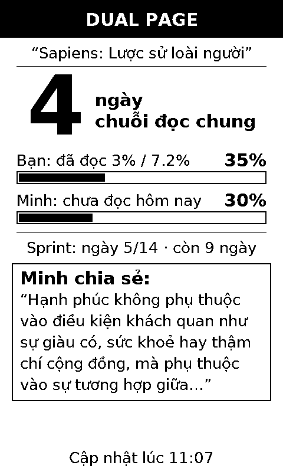
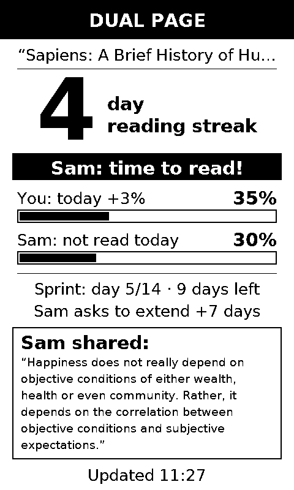
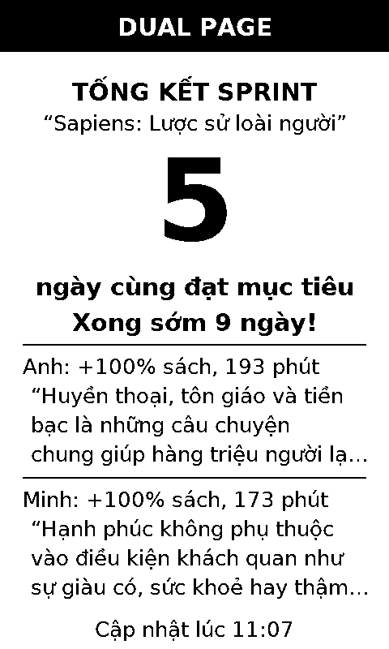
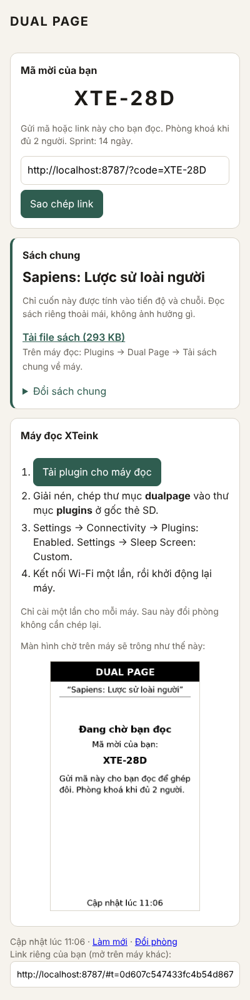
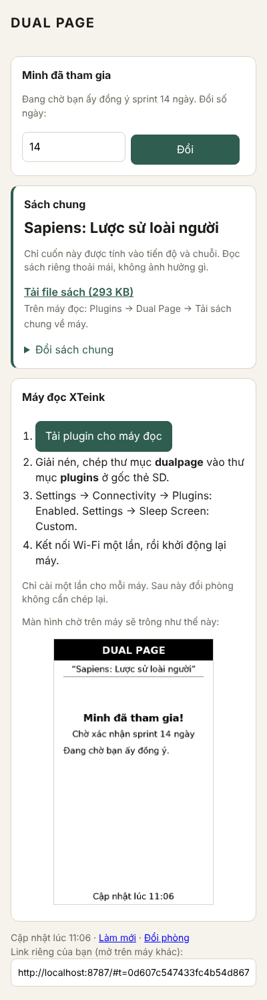
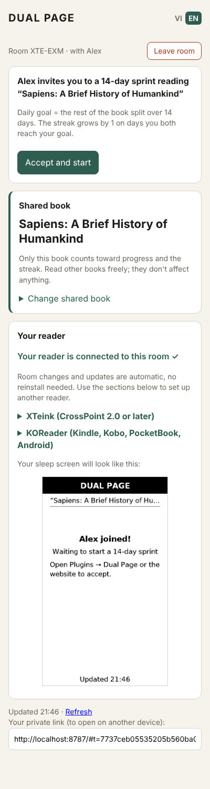
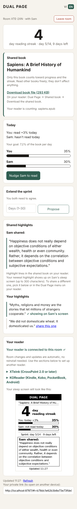
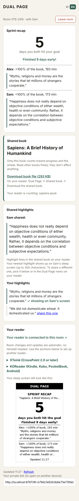

# Dual Page

**Đọc sách cùng nhau, giữ lửa mỗi ngày.** Dual Page ghép hai người đọc thành một cặp. Hai bạn đọc chung một cuốn sách trong một "sprint" có thời hạn và giữ chung một chuỗi ngày đọc (Duo Streak). Mỗi khi máy đi ngủ, màn hình chờ e-ink hiện tiến độ của cả hai và câu highlight bạn kia vừa chia sẻ.

- Trang web: **https://dualpage.online**
- Thiết bị: XTeink X4 / X4 Pro chạy firmware **CrossPoint 2.0.0** trở lên, cài plugin qua thẻ SD, không cần flash firmware.
- Thiết bị khác: Kindle, Kobo, PocketBook, Android có **KOReader**. Hai người dùng hai loại máy khác nhau vẫn vào chung một phòng.
- **[Hướng dẫn sử dụng chi tiết](docs/HUONG-DAN-SU-DUNG.md)** ([PDF](docs/DualPage-HuongDanSuDung.pdf)) · **English:** [User guide](docs/USER-GUIDE.md) ([PDF](docs/DualPage-UserGuide.pdf))
- Giao diện có tiếng Việt và tiếng Anh (nút VI | EN trên web). Mỗi người chọn ngôn ngữ riêng, màn hình chờ và menu trên máy theo ngôn ngữ đó.

---

## Tính năng

| | |
|---|---|
| **Phòng 2 người** | Người tạo phòng nhận mã mời dạng `XTE-XXX`. Phòng khoá khi đủ 2 người. |
| **Sách chung** | Khi tạo phòng, người tạo nhập tên sách và/hoặc tải file epub lên (tối đa 24 MB). Bạn đọc tải đúng file đó về máy từ menu Dual Page. Chỉ sách chung được tính vào tiến độ. Đọc sách riêng vẫn thoải mái, chỉ không được tính. |
| **Sprint** | Người tạo chọn 7, 14, 21, 30 ngày hoặc số ngày tuỳ ý, người kia bấm đồng ý. Gia hạn +3, +7 hoặc số ngày tuỳ chọn (1–30) khi cả hai cùng đồng ý. |
| **Duo Streak** | Một ngày được tính khi **cả hai** cùng đọc, theo múi giờ của từng người. Mục tiêu mỗi ngày được tính tự động từ phần sách còn lại và số ngày còn lại. |
| **Tiến độ tự động** | Máy tự gửi tiến độ sau mỗi phiên đọc. Không cần nhập tay. Sách được nhận diện qua tên file hoặc mã KOSync (partial MD5). |
| **Chia sẻ highlight** | Highlight trên máy được đồng bộ về Dual Page. Câu mới nhất tự hiện trên màn hình chờ của bạn kia, hoặc chọn câu khác trong menu hay trên web. Giới hạn **140 ký tự**, câu dài hơn được rút gọn. |
| **Nhắc đọc** | Bấm "Nhắc … đọc" ngay trên máy hoặc trên web. Lời nhắc hiện ở màn hình chờ và menu của bạn kia. |
| **Recap** | Hết sprint thì có màn tổng kết: chuỗi dài nhất, số ngày đọc, % mỗi người. |

## Giao diện

### Màn hình chờ e-ink (480×800, 1-bit)

| Chờ bạn vào | Chờ đồng ý sprint | Đang đọc | Được nhắc + gia hạn | Tổng kết |
|---|---|---|---|---|
|  |  |  |  |  |

Server vẽ ảnh BMP với font tiếng Việt dựng sẵn, và màn hình chỉ đổi khi máy đi ngủ nên rất tiết kiệm pin.

### Trang web

| Tạo phòng | Vào phòng | Chờ bạn |
|---|---|---|
|  |  |  |

| Chủ phòng chờ đồng ý | Khách đồng ý sprint |
|---|---|
|  |  |

| Đang đọc | Được nhắc + đề nghị gia hạn | Tổng kết |
|---|---|---|
|  |  |  |

### Menu trên máy (Home → Plugins → Dual Page)

```
Chuỗi đọc chung: 4 ngày              Sprint ngày 5/14, còn 9 ngày
Sách chung: Sapiens: Lược sử loài người
Tải sách chung về máy                Lưu vào thư mục DualPage
Bạn: đã đọc 3% / mục tiêu 7%         Tiến độ 35%
Minh: chưa đọc hôm nay               Tiến độ 30%
Nhắc Minh đọc                        Lời nhắc hiện khi bạn ấy mở máy
Minh chia sẻ: “Hạnh phúc không phụ thuộc vào …”
Câu bạn đang chia sẻ: “Huyền thoại, tôn giáo và tiền bạc …”
Chia sẻ: “Chúng ta không thuần hoá lúa mì. …”   Chương 5
Đề nghị gia hạn +3 ngày / +7 ngày
```

---

## Bắt đầu nhanh (XTeink + CrossPoint)

Hướng dẫn đầy đủ cho cả XTeink và KOReader: [docs/HUONG-DAN-SU-DUNG.md](docs/HUONG-DAN-SU-DUNG.md).

1. Cập nhật máy lên **CrossPoint 2.0.0** trở lên.
2. Vào **dualpage.online**, tạo phòng (nhập tên sách, có thể tải epub lên) hoặc nhập mã mời để vào phòng.
3. Bấm **Tải plugin cho máy**, giải nén vào thẻ SD sao cho có thư mục `/plugins/dualpage/`. Mỗi máy chỉ cài **một lần**. Đổi phòng sau này không cần cài lại.
4. Trên máy: **Settings → Connectivity → Plugins** → bật Dual Page.
5. **Settings → Sleep Screen → Custom** để màn hình chờ hiện Dual Page.
6. Trong trang cài đặt plugin, bấm **Bật chia sẻ highlight**. Nút này trỏ KOSync của máy về Dual Page để đồng bộ highlight.
7. Mở **Home → Plugins → Dual Page** để xem trạng thái, tải sách chung, nhắc bạn, chia sẻ câu hay hoặc gia hạn.

Máy cần Wi‑Fi lúc đi ngủ để gửi tiến độ và tải màn hình chờ mới.

---

Phần kỹ thuật (cấu trúc mã, API, chạy local, deploy) nằm ở [docs/DEVELOPMENT.md](docs/DEVELOPMENT.md).

---

## Lộ trình

- [x] Phòng 2 người, mã mời, sprint, gia hạn, Duo Streak
- [x] Màn hình chờ e-ink tiếng Việt
- [x] Sách chung (tên sách và file epub), tiến độ tự động
- [x] Chia sẻ highlight lên màn hình chờ của bạn kia (tự động và chọn tay)
- [x] Nhắc đọc từ máy và từ web
- [x] Tên miền dualpage.online
- [x] Plugin KOReader (Kindle, Kobo), dùng chung phòng với XTeink (chờ test trên máy thật)
- [ ] Làm mới giao diện trang web cho đẹp và bắt mắt hơn
- [ ] Chỗ đặt quảng cáo cho nhà sách, nhà xuất bản và nhãn hàng trên trang Dual Page
- [ ] Nút "Đọc cuốn tiếp theo" sau khi hết sprint, giữ nguyên phòng
- [x] Bản tiếng Anh: web, màn hình chờ, menu máy, plugin, hướng dẫn
