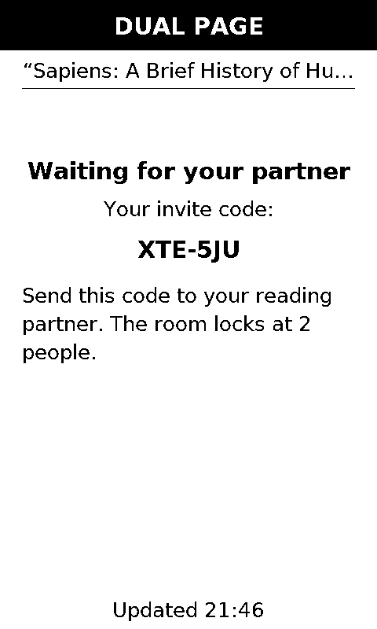
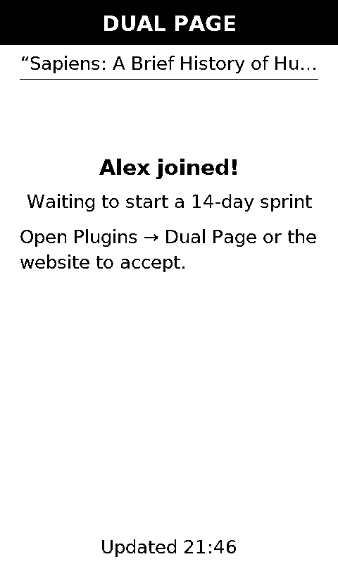
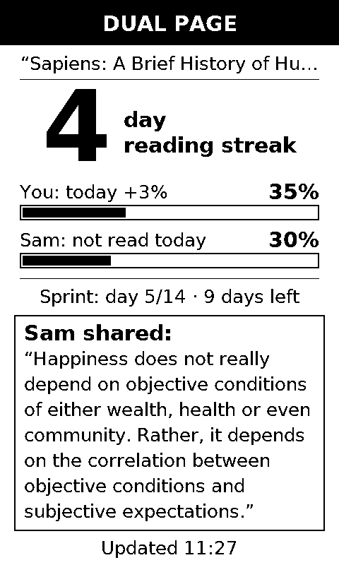
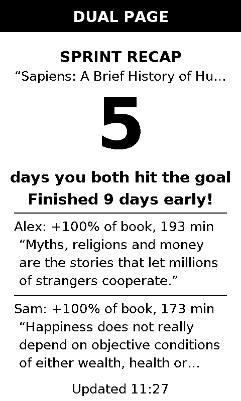
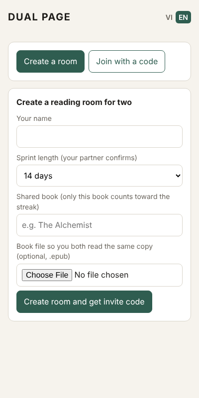
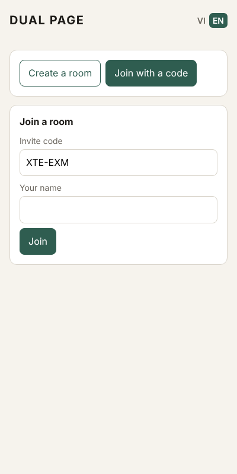
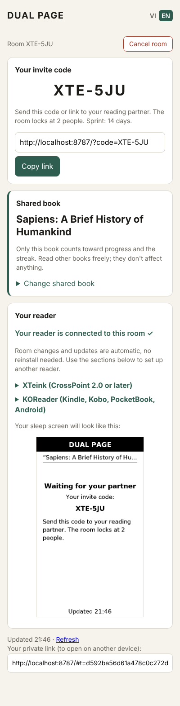
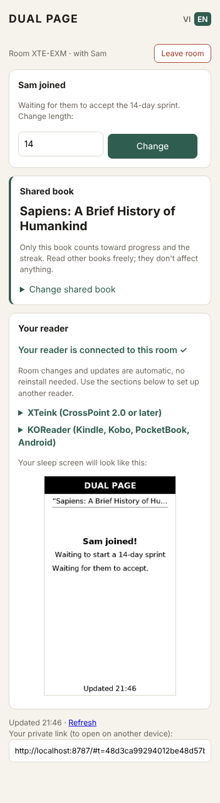
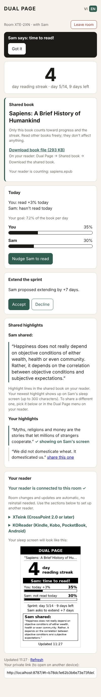

# Dual Page

**Read together, keep the streak alive.** Dual Page pairs two readers. You read the same book in a time-boxed "sprint" and share one reading streak (the Duo Streak). Every time the reader goes to sleep, the e-ink sleep screen shows both people's progress and the latest highlight your partner shared.

- Website: **https://dualpage.online**
- Readers: XTeink X4 / X4 Pro on **CrossPoint 2.0.0** or later, installed as an SD-card plugin (no firmware flashing).
- Other readers: Kindle, Kobo, PocketBook and Android with **KOReader**. Two people on different readers can share one room.
- **[User guide](docs/USER-GUIDE.md)** ([PDF](docs/DualPage-UserGuide.pdf)) · **Tiếng Việt:** [Hướng dẫn sử dụng](docs/HUONG-DAN-SU-DUNG.md) ([PDF](docs/DualPage-HuongDanSuDung.pdf))
- The interface is in English and Vietnamese (VI | EN on the website). Each person picks their own language; their sleep screen and reader menu follow it.

---

## Features

| | |
|---|---|
| **Rooms for two** | The host gets an invite code like `XTE-XXX`. The room locks once two people are in. |
| **Shared book** | When creating the room, the host enters the book title and/or uploads an epub (up to 24 MB). The partner downloads that exact file from the Dual Page menu on their reader. Only the shared book counts toward progress; other books are fine, they just don't count. |
| **Sprint** | The host picks 7, 14, 21, 30 days or any length, and the partner accepts. Extend by 1–30 days when both agree. |
| **Duo Streak** | A day counts when **both** of you read, each in your own time zone. The daily goal is worked out from what's left of the book and the days left. |
| **Automatic progress** | The reader sends progress after each reading session. Nothing to type. The book is recognised by file name or KOSync document ID (partial MD5). |
| **Shared highlights** | Highlights sync to Dual Page. Your newest one shows on your partner's sleep screen. The Highlights section shows what each of you is sharing now and the earlier shared quotes (the 10 latest per reader, up to 300 characters each). |
| **Nudges** | Tap "Send a nudge" on the reader or the website. It shows on your partner's sleep screen and menu. |
| **Recap** | When the sprint ends you get a summary: shared days, days early, progress and minutes for each of you. |

## Screens

### E-ink sleep screen (480×800, 1-bit)

| Waiting for partner | Waiting to start | Reading | Nudged + extension | Recap |
|---|---|---|---|---|
|  |  |  |  |  |

The server draws a BMP with a built-in font (full Vietnamese diacritics), and the screen only changes when the reader sleeps, so it costs almost no battery.

### Website

| Create a room | Join | Waiting for partner |
|---|---|---|
|  |  |  |

| Host waiting to start | Partner accepts the sprint |
|---|---|
|  |  |

| Reading | Nudged + extension request | Recap |
|---|---|---|
|  |  |  |

### Reader menu (Home → Plugins → Dual Page)

Four sections. Each title shows what's new, e.g. **Today · Minh nudged you to read!**

| Section | What's in it |
|---|---|
| **Today** | Shared streak, what each of you read today, nudge button, nudges you received |
| **Highlights** | What you're sharing with your partner, what they're sharing with you, and earlier shared quotes |
| **Shared book** | Book title, the file you're reading, download the shared book |
| **Sprint & extension** | Day X of Y, days left, daily goal, request or accept an extension |

---

## Quick start (XTeink + CrossPoint)

Full guide for XTeink and KOReader: [docs/USER-GUIDE.md](docs/USER-GUIDE.md).

1. Update the reader to **CrossPoint 2.0.0** or later.
2. On **dualpage.online**, create a room (enter the book title, optionally upload the epub) or enter an invite code to join.
3. Tap **Download the XTeink plugin** and unzip it onto the SD card so you have `/plugins/dualpage/`. Install **once** per reader; switching rooms later doesn't need a reinstall.
4. On the reader: **Settings → Connectivity → Plugins** → turn on Enabled.
5. **Settings → Sleep Screen → Custom** so the sleep screen shows Dual Page.
6. Turn on highlight sharing: open **File Transfer** on the reader, open the address it shows on a computer on the same Wi-Fi, go to **Plugins** and click **Turn on highlight sharing**.
7. Open **Home → Plugins → Dual Page** to see your status, download the shared book, nudge your partner, or extend the sprint.

The reader needs Wi-Fi when it goes to sleep to send progress and fetch the new sleep screen.

---

Technical notes (code layout, API, running locally, deploy) are in [docs/DEVELOPMENT.md](docs/DEVELOPMENT.md).

---

## Roadmap

- [x] Rooms for two, invite codes, sprints, extensions, Duo Streak
- [x] E-ink sleep screen
- [x] Shared book (title and epub file), automatic progress
- [x] Shared highlights on the partner's sleep screen, with share history
- [x] Nudges from the reader and the website
- [x] dualpage.online domain
- [x] KOReader plugin (Kindle, Kobo), sharing rooms with XTeink
- [x] English: website, sleep screen, reader menus, plugins, guides
- [ ] A fresher, more eye-catching website design
- [ ] Ad spots for bookshops, publishers and brands on Dual Page
- [ ] "Read the next book" after a sprint, keeping the same room
