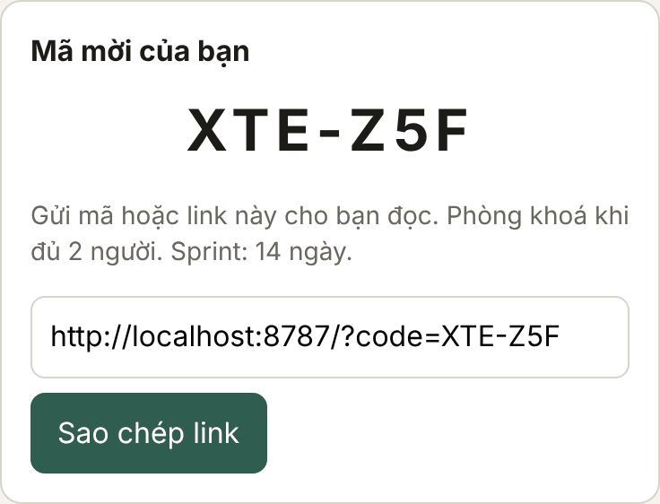
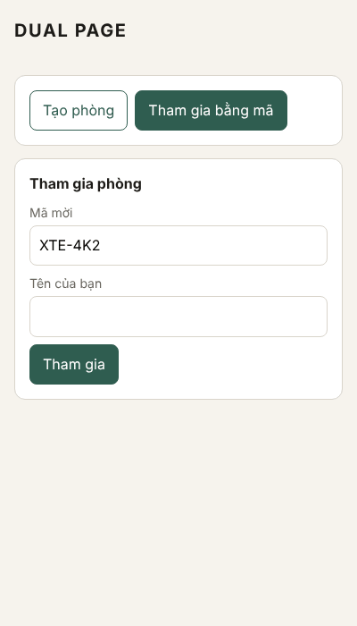
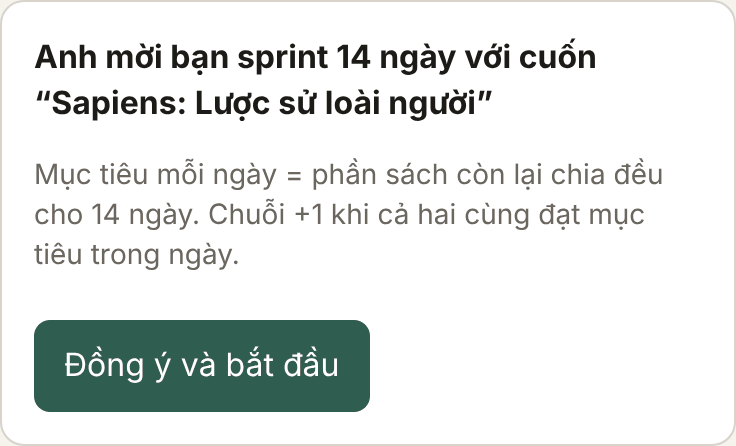
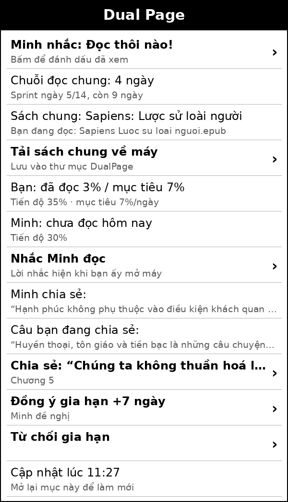
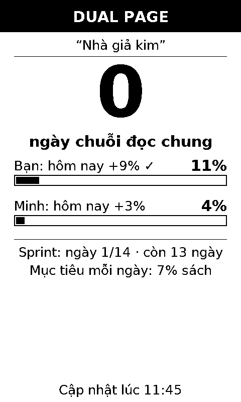
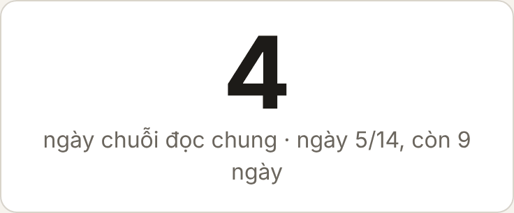
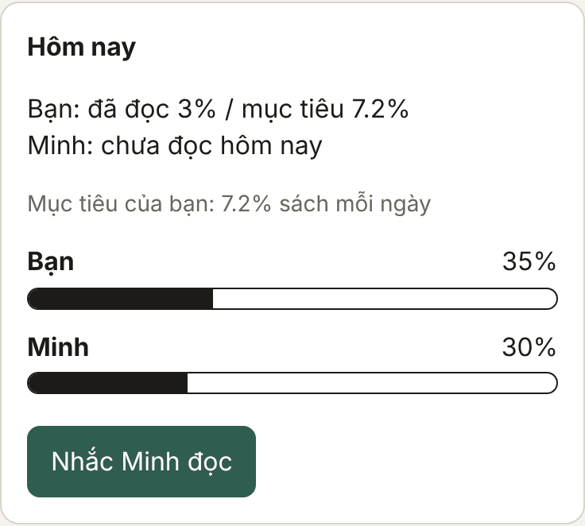
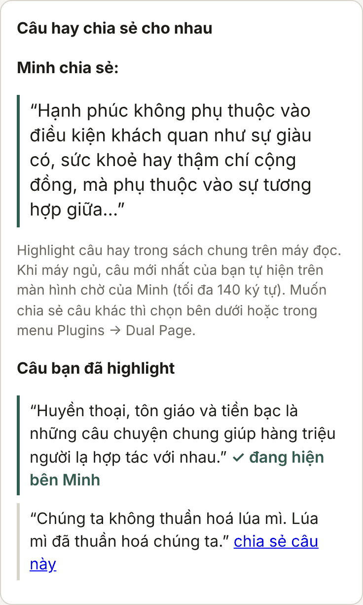
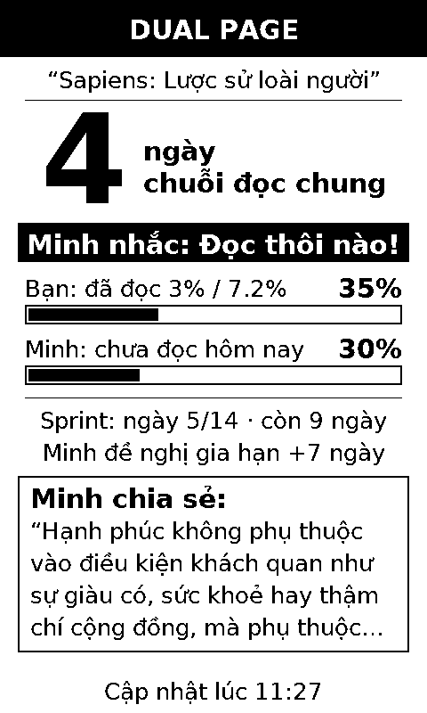

# Hướng dẫn sử dụng Dual Page

Dual Page giúp hai người đọc chung một cuốn sách, mỗi người trên máy của mình. Hai bạn có thể dùng **hai loại máy khác nhau**: một người dùng XTeink, người kia dùng Kindle hoặc Kobo có KOReader vẫn vào chung một phòng.

Mục lục:
1. [Tạo phòng và mời bạn đọc](#1-tạo-phòng-và-mời-bạn-đọc)
2. [Cài cho máy XTeink (CrossPoint)](#2-cài-cho-máy-xteink-crosspoint)
3. [Cài cho Kindle, Kobo… (KOReader)](#3-cài-cho-kindle-kobo-koreader)
4. [Đọc hằng ngày](#4-đọc-hằng-ngày)
5. [Chia sẻ câu hay (highlight)](#5-chia-sẻ-câu-hay-highlight)
6. [Nhắc bạn đọc, gia hạn sprint](#6-nhắc-bạn-đọc-gia-hạn-sprint)
7. [Tiến độ và chuỗi ngày được tính thế nào](#7-tiến-độ-và-chuỗi-ngày-được-tính-thế-nào)
8. [Câu hỏi thường gặp và xử lý lỗi](#8-câu-hỏi-thường-gặp-và-xử-lý-lỗi)

---

## 1. Tạo phòng và mời bạn đọc

Làm trên điện thoại hoặc máy tính, ở **https://dualpage.online**.

**Người tạo phòng**
1. Nhập tên của bạn.
2. Nhập **tên sách chung**. Nếu có file epub, bấm chọn file để tải lên (tối đa 24 MB). Bạn đọc sẽ tải đúng file này về máy.
3. Chọn độ dài sprint: 7, 14, 21, 30 ngày hoặc số ngày tuỳ ý.
4. Bấm **Tạo phòng**. Bạn nhận được mã mời dạng `XTE-ABC`. Gửi mã này cho bạn đọc.

 

**Người được mời**
1. Mở dualpage.online, chọn **Vào phòng**, nhập tên và mã mời.
2. Xem độ dài sprint rồi bấm **Đồng ý**. Sprint bắt đầu từ lúc này.

 

Phòng chỉ có 2 người. Trang web nhớ phòng của bạn trên trình duyệt đó. Muốn mở phòng trên máy khác, dùng **link riêng** ở cuối trang (link có `#t=`). Đừng gửi link này cho người khác.

---

## 2. Cài cho máy XTeink (CrossPoint)

**Cần có:** XTeink X4 hoặc X4 Pro chạy firmware **CrossPoint 2.0.0 trở lên**. Bản cũ hơn không có mục Plugins. Nếu không thấy mục này, hãy cập nhật firmware trước.

1. Trên dualpage.online, mục **Máy đọc** → **XTeink** → bấm **Tải plugin cho XTeink**.

   

2. Giải nén file vừa tải. Bạn được thư mục `dualpage`.
3. Cắm thẻ SD vào máy tính, chép thư mục `dualpage` vào thư mục `plugins` ở gốc thẻ. Kết quả là `/plugins/dualpage/`. Nếu chưa có thư mục `plugins` thì tạo mới.
4. Lắp thẻ lại vào máy. Vào **Settings → Connectivity → Plugins** và bật **Enabled**.
5. Vào **Settings → Sleep Screen** và chọn **Custom**, để màn hình chờ hiện Dual Page.
6. Kết nối Wi-Fi một lần, rồi khởi động lại máy.
7. Vào trang cài đặt của plugin Dual Page và bấm **Bật chia sẻ highlight**. Nút này cài đồng bộ highlight (KOSync) về Dual Page.

**Mở Dual Page trên máy:** Home → Plugins → **Dual Page**.

Menu chia thành 4 mục. Tên mục cho biết ngay có gì mới, ví dụ **Hôm nay · Minh nhắc bạn đọc!**

| Mục | Có gì |
|---|---|
| **Hôm nay** | Chuỗi đọc chung, bạn và bạn đọc đã đọc bao nhiêu hôm nay, nút nhắc đọc, lời nhắc nhận được |
| **Câu hay** | Câu bạn đọc chia sẻ, câu bạn đang chia sẻ, chọn câu khác để chia sẻ |
| **Sách chung** | Tên sách, file bạn đang đọc, tải sách chung về máy |
| **Sprint và gia hạn** | Ngày thứ mấy, còn bao nhiêu ngày, mục tiêu mỗi ngày, đề nghị hoặc đồng ý gia hạn |

*Menu Dual Page trên máy (minh họa). Dòng chữ đậm có dấu › là nút bấm được.*

---

> **Dòng nào bấm được?** Trong menu Dual Page, dòng có dấu **»** ở đầu là nút bấm (nhắc đọc, chia sẻ câu, gia hạn, tải sách). Các dòng còn lại chỉ để xem. Trên XTeink, lỡ bấm vào dòng xem thì máy hiện "Tải về xong", không ảnh hưởng gì.

## 3. Cài cho Kindle, Kobo… (KOReader)

**Cần có:** máy đã cài **KOReader**. Kindle cần được jailbreak để cài KOReader. Kobo, PocketBook và Android cài KOReader bình thường.

1. Trên dualpage.online, mục **Máy đọc** → **KOReader** → bấm **Tải plugin cho KOReader**.
2. Giải nén file vừa tải. Bạn được thư mục `dualpage.koplugin`.
3. Cắm máy vào máy tính và chép thư mục đó vào thư mục plugin của KOReader:

   | Máy | Chép vào |
   |---|---|
   | Kindle | `koreader/plugins/` |
   | Kobo | `.adds/koreader/plugins/` (thư mục `.adds` có thể bị ẩn) |
   | PocketBook | `applications/koreader/plugins/` |
   | Android | `koreader/plugins/` trong bộ nhớ máy |

4. Rút cáp và **khởi động lại KOReader**.
5. Mở menu chính của KOReader (chạm phần trên màn hình), vào **Dual Page** → bật **Dùng màn hình chờ Dual Page**.
6. Mở **Dual Page → Mở Dual Page** để xem trạng thái phòng.

Menu Dual Page trên KOReader có cùng các dòng như ảnh menu ở mục 2.

**Lưu ý cho Kindle:** màn hình chờ Dual Page chỉ hiện khi KOReader điều khiển việc ngủ. Nếu Kindle vẫn hiện màn hình chờ của Amazon, vào menu của KOReader → **Màn hình → Màn hình chờ** và kiểm tra lại. Máy Kindle có quảng cáo (Special Offers) có thể luôn hiện quảng cáo của Amazon.

Tắt màn hình chờ Dual Page: bỏ chọn **Dùng màn hình chờ Dual Page**. KOReader trở lại kiểu màn hình chờ cũ của bạn.

---

## 4. Đọc hằng ngày

1. Mở **sách chung** và đọc như bình thường. Chỉ sách chung được tính tiến độ. Bạn vẫn đọc sách khác thoải mái, chúng chỉ không được tính.
2. Nếu người tạo phòng đã tải epub lên, mở menu Dual Page trên máy và chọn **Tải sách chung về máy**. Sách được lưu vào thư mục `DualPage`. Lần đầu, mở sách bằng **Home → Duyệt file → DualPage**. Sách mới tải chưa mở lần nào có thể nằm cuối Thư viện; đọc một lần là sách lên mục Gần đây.
3. Khi máy có Wi-Fi, tiến độ được gửi tự động:
   - **XTeink:** sau mỗi phiên đọc, lúc máy đi ngủ.
   - **KOReader:** trong lúc đọc (khoảng 10 phút một lần), khi đóng sách và khi máy đi ngủ. Muốn gửi ngay thì vào **Dual Page → Gửi tiến độ và cập nhật màn hình chờ**.
4. Cho máy ngủ là thấy màn hình chờ Dual Page: chuỗi ngày đọc chung, tiến độ của cả hai, câu bạn kia chia sẻ và lời nhắc nếu có.

| XTeink | Kindle (KOReader) |
|---|---|
|  |  |

Trên web, mục **Hôm nay** cho thấy cùng thông tin:

 

Không có Wi-Fi cũng không sao. Máy giữ lại và gửi khi có mạng.

---

## 5. Chia sẻ câu hay (highlight)

Mỗi lần bạn highlight trong sách chung, câu đó được gửi về Dual Page. **Câu mới nhất tự hiện trên màn hình chờ của bạn đọc.** Câu dài hơn 140 ký tự được rút gọn để vừa màn hình.

Muốn chọn một câu khác:
- **Trên máy:** mở menu Dual Page, chọn một dòng **Chia sẻ: "…"**.
- **Trên web:** mục **Câu hay chia sẻ cho nhau**, bấm **chia sẻ câu này**.

  

- **KOReader:** chọn đoạn chữ rồi bấm **Chia sẻ Dual Page** trong bảng highlight. Câu đó được chia sẻ ngay, kể cả khi bạn không lưu highlight.

  

  *Nút Chia sẻ Dual Page trong bảng highlight của KOReader (minh họa).*

Màn hình chờ của bạn đọc đổi sang câu mới vào lần kế tiếp máy của họ đi ngủ có mạng.

---

## 6. Nhắc bạn đọc, gia hạn sprint

**Nhắc đọc**
- Khi bạn kia chưa đọc hôm nay, menu Dual Page trên máy và trang web có nút **Nhắc … đọc**.
- Lời nhắc hiện trên màn hình chờ và menu của bạn kia.
- Lời nhắc tự mất khi bạn kia đọc thêm sách chung, hoặc khi họ bấm **đã xem** trên máy hay trên web.

  

**Gia hạn sprint**
- Một người đề nghị gia hạn thêm **số ngày tuỳ chọn** (1–30) trên máy hoặc web.
  - Trên web: nhập số ngày vào ô "Số ngày" rồi bấm **Đề nghị**.
  - Trên XTeink: mở Plugins → Dual Page, bấm **biểu tượng kính lúp** ở thanh tiêu đề (máy không cảm ứng: chọn dòng đầu tiên rồi bấm nút Trái), gõ số ngày (ví dụ `5`), rồi chọn **» Đề nghị gia hạn +5 ngày**. Dòng "Gia hạn sprint" trong mục chỉ là lời nhắc, bấm vào không mở bàn phím. Cần plugin bản 0.3.1 trở lên (tải lại plugin trên web một lần).
  - Trên KOReader: chọn **» Đề nghị gia hạn…** rồi nhập số ngày.
- Người kia bấm **Đồng ý** hoặc **Từ chối**. Chỉ gia hạn khi cả hai đồng ý.

  

**Hết sprint:** máy và web hiện màn **Tổng kết** với số ngày cùng đạt mục tiêu, phần trăm sách mỗi người đã đọc và số phút đọc.

---

## 7. Tiến độ và chuỗi ngày được tính thế nào

- **Tiến độ** là vị trí xa nhất bạn đã đọc tới trong sách chung, ví dụ 35%. Lật lùi để đọc lại không bị trừ. Lật qua lật lại một đoạn cũng không được cộng thêm.
- **Đọc hôm nay** là vị trí xa nhất hôm nay trừ vị trí xa nhất trước hôm nay.
- **Mục tiêu mỗi ngày** là phần sách còn lại lúc bắt đầu sprint chia cho số ngày. Ví dụ bắt đầu ở 0% với sprint 14 ngày thì mục tiêu khoảng 7% mỗi ngày.
- **Chuỗi đọc chung** tăng 1 vào ngày **cả hai** cùng đạt mục tiêu. Ngày được tính theo múi giờ của từng người.
- Tiến độ chỉ tính theo **vị trí trong sách**, không đếm số lần lật trang. Hiện tại nếu nhảy thẳng tới cuối sách thì vẫn được tính là đã đọc tới đó, nên hai bạn chơi đẹp với nhau nhé.

---

## 8. Câu hỏi thường gặp và xử lý lỗi

**Mỗi lần đổi phòng có phải cài lại plugin không?**
Không. Mỗi máy cài một lần. Khi bạn tạo hoặc vào phòng mới **trên cùng trình duyệt** đã tải plugin, máy tự chuyển sang phòng mới.

**XTeink không thấy mục Plugins.**
Máy đang chạy CrossPoint cũ. Cập nhật lên 2.0.0 trở lên.

**Màn hình chờ không đổi.**
- XTeink: kiểm tra Sleep Screen = **Custom** và máy có Wi-Fi lúc đi ngủ.
- KOReader: kiểm tra đã bật **Dùng màn hình chờ Dual Page**. Ảnh được cập nhật khi có mạng, nên ảnh bạn thấy là lần cập nhật gần nhất.

**Tiến độ không tăng.**
Bạn có thể đang đọc một file khác với sách chung. Menu Dual Page hiện dòng **Bạn đang đọc: …** để kiểm tra. Cách chắc nhất là tải sách chung từ menu Dual Page.

**Menu Dual Page báo "Máy chưa vào phòng nào".**
Mở dualpage.online trên trình duyệt đã tải plugin, tạo hoặc vào một phòng, rồi mở lại menu.

**Plugin có an toàn không?**
Plugin chỉ gửi tên file sách, vị trí đọc, thời gian đọc và các câu highlight của sách chung về dualpage.online. File `config.json` (XTeink) và `dualpage_config.lua` (KOReader) chứa mã riêng của máy bạn, đừng chia sẻ.
