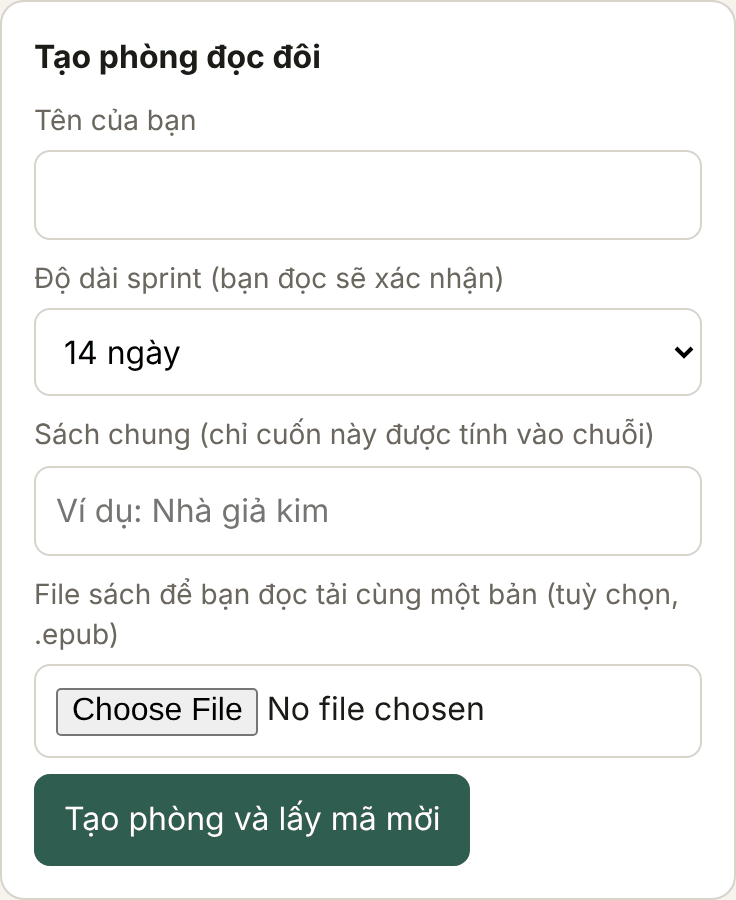
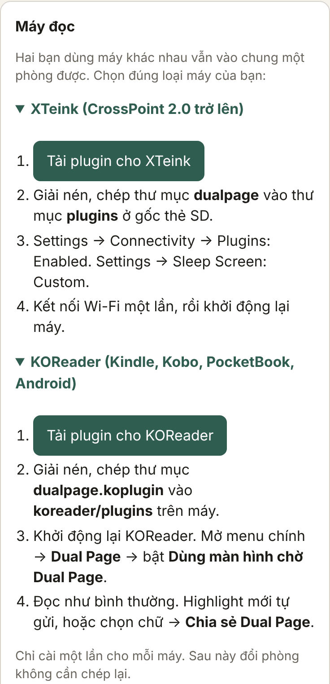
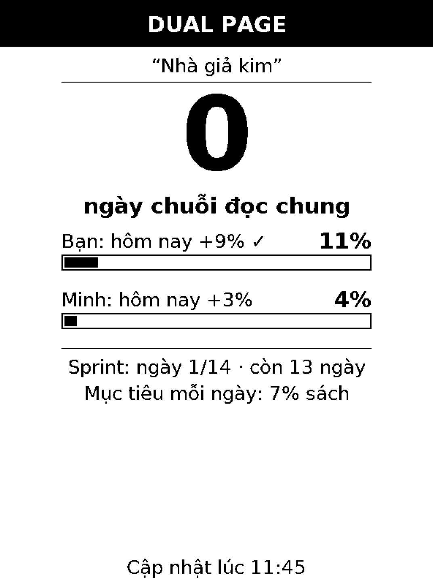
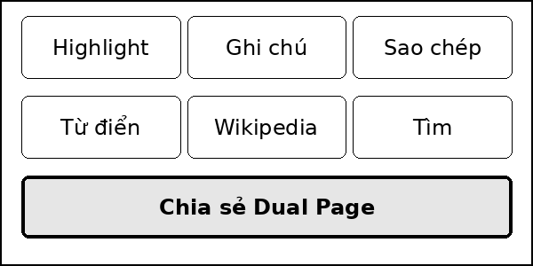
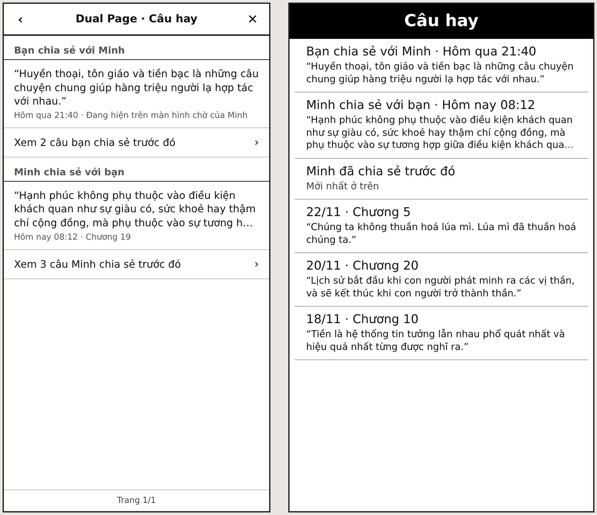
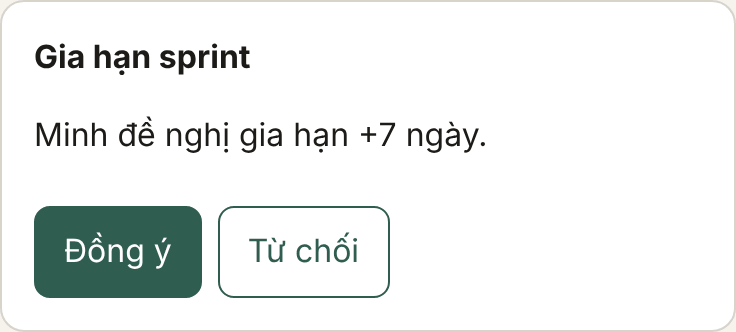
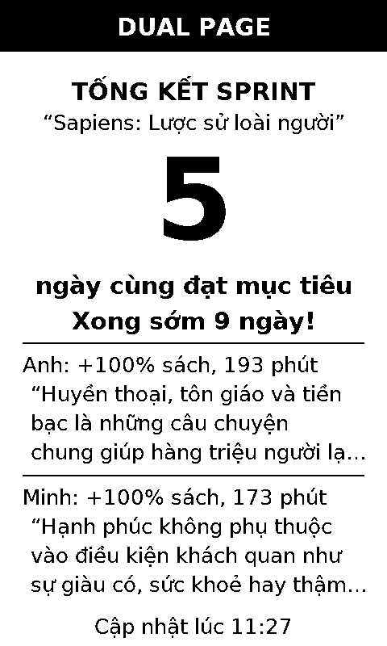

# Hướng dẫn sử dụng Dual Page

Dual Page giúp hai người đọc chung một cuốn sách, mỗi người trên máy của mình. Hai bạn có thể dùng **hai loại máy khác nhau**: một người dùng XTeink, người kia dùng Kindle hoặc Kobo có KOReader vẫn vào chung một phòng.

Mục lục:
1. [Tạo phòng và mời bạn đọc](#1-tạo-phòng-và-mời-bạn-đọc)
2. [Cài cho máy XTeink (CrossPoint)](#2-cài-cho-máy-xteink-crosspoint)
3. [Cài cho Kindle, Kobo… (KOReader)](#3-cài-cho-kindle-kobo-koreader)
4. [Đọc hằng ngày](#4-đọc-hằng-ngày)
5. [Chia sẻ câu hay (highlight)](#5-chia-sẻ-câu-hay-highlight)
6. [Nhắc bạn đọc, gia hạn sprint](#6-nhắc-bạn-đọc-gia-hạn-sprint)
7. [Tiến độ và chuỗi ngày được tính thế nào](#7-tiến-độ-và-chuỗi-ngày-được-tính-thế-nào)
8. [Câu hỏi thường gặp và xử lý lỗi](#8-câu-hỏi-thường-gặp-và-xử-lý-lỗi)

---

## 1. Tạo phòng và mời bạn đọc

Làm trên điện thoại hoặc máy tính, ở **https://dualpage.online**.

**Người tạo phòng**
1. Nhập tên của bạn.
2. Nhập **tên sách chung**. Nếu có file epub, bấm chọn file để tải lên (tối đa 24 MB). Bạn đọc sẽ tải đúng file này về máy.
3. Chọn độ dài sprint: 7, 14, 21, 30 ngày hoặc số ngày tuỳ ý.
4. Bấm **Tạo phòng**. Bạn nhận được mã mời dạng `XTE-ABC`. Gửi mã này cho bạn đọc.

 

**Người được mời**
1. Mở dualpage.online, chọn **Vào phòng**, nhập tên và mã mời.
2. Xem độ dài sprint rồi bấm **Đồng ý**. Sprint bắt đầu từ lúc này.

 

Phòng chỉ có 2 người. Không cần tài khoản: trang web nhớ phòng của bạn bằng một mã riêng lưu trong trình duyệt. Muốn mở phòng trên máy khác, dùng **link riêng** ở cuối trang (link có `#t=`). Đừng gửi link này cho người khác.

**Rời phòng:** bấm nút **Rời phòng** ở đầu trang, xem lại rồi xác nhận. Bạn đọc kia được báo trên web, màn hình chờ và menu máy đọc, kèm phần tổng kết chuỗi ngày và tiến độ. Phòng đóng lại, mã mời cũ hết dùng được và file sách chung bị xoá. Sau đó bạn tạo hoặc vào phòng mới, máy đọc tự chuyển theo. Khi chưa có ai vào phòng, nút này là **Huỷ phòng**.

---

## 2. Cài cho máy XTeink (CrossPoint)

**Cần có:** XTeink X4 hoặc X4 Pro chạy firmware **CrossPoint 2.0.0 trở lên**. Bản cũ hơn không có mục Plugins. Nếu không thấy mục này, hãy cập nhật firmware trước.

1. Trên dualpage.online, mục **Máy đọc** → **XTeink** → bấm **Tải plugin cho XTeink**.

   

2. Giải nén file vừa tải. Bạn được thư mục `dualpage`.
3. Cắm thẻ SD vào máy tính, chép thư mục `dualpage` vào thư mục `plugins` ở gốc thẻ. Kết quả là `/plugins/dualpage/`. Nếu chưa có thư mục `plugins` thì tạo mới.
4. Lắp thẻ lại vào máy. Vào **Settings → Connectivity → Plugins** và bật **Enabled**.
5. Vào **Settings → Sleep Screen** và chọn **Custom**, để màn hình chờ hiện Dual Page.
6. Kết nối Wi-Fi một lần, rồi khởi động lại máy.
7. Vào trang cài đặt của plugin Dual Page và bấm **Bật chia sẻ highlight**. Nút này cài đồng bộ highlight (KOSync) về Dual Page.

   **Hoặc làm ngay trên máy:** mở Dual Page → mục **Câu hay**. Khi chưa bật, mục này hiện mã 6 ký tự của máy bạn và các dòng cần nhập. Vào **Settings → CrossPoint Sync** và nhập:
   - Server Type: **KoSync**
   - Sync Server URL: **https://dualpage.online/kosync**
   - Username: **mã 6 ký tự** (viết hoa hay thường đều được)
   - Password: **dualpage**
   - Document Matching: **Binary**
   - Sync Clippings: **On**

   Sau lần đồng bộ đầu tiên, các dòng hướng dẫn tự ẩn.

**Mở Dual Page trên máy:** Home → Plugins → **Dual Page**.

Menu chia thành 4 mục. Tên mục cho biết ngay có gì mới, ví dụ **Hôm nay · Minh nhắc bạn đọc!**

| Mục | Có gì |
|---|---|
| **Hôm nay** | Chuỗi đọc chung, bạn và bạn đọc đã đọc bao nhiêu hôm nay, nút nhắc đọc, lời nhắc nhận được |
| **Câu hay** | Câu bạn đang chia sẻ, câu bạn đọc đang chia sẻ, và các câu bạn đọc đã chia sẻ trước đó |
| **Sách chung** | Tên sách, file bạn đang đọc, tải sách chung về máy |
| **Sprint và gia hạn** | Ngày thứ mấy, còn bao nhiêu ngày, mục tiêu mỗi ngày, đề nghị hoặc đồng ý gia hạn |

*Menu Dual Page trên máy (minh họa). Dòng chữ đậm có dấu › là nút bấm được.*

---

> **Dòng nào bấm được?** Trong menu Dual Page, dòng có dấu **»** ở đầu là nút bấm (nhắc đọc, gia hạn, tải sách). Các dòng còn lại chỉ để xem. Trên XTeink, lỡ bấm vào dòng xem thì máy hiện "Tải về xong", không ảnh hưởng gì.

## 3. Cài cho Kindle, Kobo… (KOReader)

**Cần có:** máy đã cài **KOReader**. Kindle cần được jailbreak để cài KOReader. Kobo, PocketBook và Android cài KOReader bình thường.

1. Trên dualpage.online, mục **Máy đọc** → **KOReader** → bấm **Tải plugin cho KOReader**.
2. Giải nén file vừa tải. Bạn được thư mục `dualpage.koplugin`.
3. Cắm máy vào máy tính và chép thư mục đó vào thư mục plugin của KOReader:

   | Máy | Chép vào |
   |---|---|
   | Kindle | `koreader/plugins/` |
   | Kobo | `.adds/koreader/plugins/` (thư mục `.adds` có thể bị ẩn) |
   | PocketBook | `applications/koreader/plugins/` |
   | Android | `koreader/plugins/` trong bộ nhớ máy |

4. Rút cáp và **khởi động lại KOReader**.
5. Mở menu chính của KOReader (chạm phần trên màn hình), vào **Dual Page** → bật **Dùng màn hình chờ Dual Page**.
6. Mở **Dual Page → Mở Dual Page** để xem trạng thái phòng.

Menu Dual Page trên KOReader có cùng các dòng như ảnh menu ở mục 2.

**Plugin KOReader tự cập nhật.** Khi có bản mới, plugin tự tải về lúc bạn mở Dual Page (hoặc vài tiếng một lần khi có Wi-Fi), rồi hỏi **khởi động lại KOReader**. Bấm đồng ý là xong, không phải chép file lại.

**Mở Dual Page bằng cử chỉ (tuỳ chọn):** menu KOReader → **bánh răng → Taps and gestures → Gesture manager** → chọn cử chỉ, ví dụ **Long-press on corner → Bottom right** → **General** → kéo xuống cuối, tick **Dual Page**. KOReader lưu cử chỉ riêng cho lúc đọc sách và lúc ở thư viện, muốn dùng ở cả hai thì đặt hai lần.

**Lưu ý cho Kindle:** màn hình chờ Dual Page chỉ hiện khi KOReader điều khiển việc ngủ. Nếu Kindle vẫn hiện màn hình chờ của Amazon, vào menu của KOReader → **Màn hình → Màn hình chờ** và kiểm tra lại. Khi bật màn hình chờ Dual Page, plugin tự tắt dòng chữ "Sleeping" của KOReader; nếu vẫn thấy, bỏ tick ô hiện thông báo trong **Màn hình → Màn hình chờ**.

**Kindle có quảng cáo (Special Offers) luôn hiện quảng cáo của Amazon khi ngủ**: KOReader tự tắt màn hình chờ của nó trên các máy này. Có hai cách:
- **Gỡ quảng cáo hẳn** trên trang Amazon: **Quản lý nội dung và thiết bị → Thiết bị → chọn Kindle → Ưu đãi đặc biệt → Gỡ bỏ** (thường mất phí khoảng 20 USD).
- **Tạm tắt đến lần khởi động lại máy:** trong KOReader mở **Công cụ → Terminal emulator**, gõ `lipc-set-prop com.lab126.blanket unload ad_screensaver` (một dòng) rồi Enter, sau đó khởi động lại KOReader. Sau mỗi lần khởi động lại Kindle cần gõ lại.

Tiến độ, highlight và lời nhắc vẫn chạy bình thường dù còn quảng cáo.

Tắt màn hình chờ Dual Page: bỏ chọn **Dùng màn hình chờ Dual Page**. KOReader trở lại kiểu màn hình chờ cũ của bạn.

---

## 4. Đọc hằng ngày

1. Mở **sách chung** và đọc như bình thường. Chỉ sách chung được tính tiến độ. Bạn vẫn đọc sách khác thoải mái, chúng chỉ không được tính.
2. Nếu người tạo phòng đã tải epub lên, mở menu Dual Page trên máy, vào **Sách chung** → **» Tải về "…"**:
   - **XTeink:** sách được lưu vào thư mục `DualPage`. Lần đầu, mở sách bằng **Home → Duyệt file → DualPage** (firmware chưa cho sách mới tải lên đầu Thư viện). Đọc một lần là sách nằm ở mục Gần đây và Đọc tiếp.
   - **KOReader:** sách được lưu thẳng vào thư mục sách (Kindle: `documents`) và **mở luôn** sau khi tải xong. Bấm lại nút tải khi đã có sách thì sách mở ngay.
3. Tiến độ được gửi **tự động** khi máy có Wi-Fi, không cần bấm gì:
   - **XTeink:** khi thoát sách và khi máy đi ngủ.
   - **KOReader:** khoảng 15 giây sau khi lật trang, khi đóng sách và khi máy đi ngủ.
4. Cho máy ngủ là thấy màn hình chờ Dual Page: chuỗi ngày đọc chung, mỗi người hôm nay đọc thêm bao nhiêu % (✓ khi đạt mục tiêu), tổng % cuốn sách, mục tiêu mỗi ngày, câu bạn kia chia sẻ và lời nhắc nếu có. Kindle và XTeink dùng cùng một bố cục. Máy đang ngủ sẽ thấy tiến độ mới của bạn kia ở lần ngủ kế tiếp có mạng.

| XTeink | Kindle (KOReader) |
|---|---|
|  |  |

Trên web, mục **Hôm nay** cho thấy cùng thông tin:

 

Không có Wi-Fi cũng không sao. Máy giữ lại và gửi khi có mạng.

---

## 5. Chia sẻ câu hay (highlight)

Highlight trong sách chung được gửi về Dual Page. **Câu mới nhất tự hiện trên màn hình chờ của bạn đọc.** Câu dài tới **300 ký tự** (khoảng 2–3 câu) hiện đầy đủ, dài hơn thì được rút gọn. Câu càng dài thì chữ tự nhỏ lại cho vừa. Mỗi người chỉ giữ **3 highlight gần nhất**, câu cũ hơn tự bỏ đi. Riêng các câu **đã chia sẻ** thì Dual Page lưu lại **10 câu gần nhất** của mỗi người để hai bạn đọc lại trong mục **Câu hay**.

### XTeink

**Bật một lần:** làm bước 7 ở phần cài đặt XTeink (nút **Bật chia sẻ highlight** trên trang web của máy, hoặc tự nhập trong **Settings → CrossPoint Sync** theo các dòng hiện ở mục **Câu hay** của Dual Page).

**Highlight:**
- **X4:** bấm nút **Confirm** (nút thứ 2 từ trái ở hàng nút mặt trước) để mở menu trong sách → **Create Clipping**. Dùng Left/Right chọn chữ đầu, bấm Confirm, chọn chữ cuối, bấm Confirm lần nữa.
- **X4 Pro:** giữ ngón tay lên chữ trên màn hình để bắt đầu chọn.

**Gửi đi:** XTeink chỉ gửi highlight khi đồng bộ. Highlight xong, mở menu trong sách → **Sync Progress**. Máy hiện "Syncing Clippings..." rồi xong. Đồng bộ cũng gửi luôn tiến độ đọc.

**Cho nhanh, gán đồng bộ vào một nút (chỉ cần làm một lần):**
- **X4 Pro:** **Settings → Controls → Home Button Gestures**, đặt **Double Tap = CrossPoint Sync**. Đang đọc chỉ cần chạm đúp phím Home.
- **X4:** **Settings → Controls → Long-Press Menu**, chọn **CrossPoint Sync**. Đang đọc chỉ cần giữ nút Confirm.
- Để **Settings → CrossPoint Sync → Sync Behavior = Smart Sync** (mặc định) thì máy không hỏi gì, tự gửi.

### KOReader (Kindle, Kobo…)

Highlight như bình thường là câu tự gửi đi khi có Wi-Fi. Muốn chia sẻ ngay một câu: chọn đoạn chữ rồi bấm **Chia sẻ Dual Page** trong bảng highlight. Câu đó được chia sẻ ngay, kể cả khi bạn không lưu highlight.

  

  *Nút Chia sẻ Dual Page trong bảng highlight của KOReader (minh họa).*

### Xem lại câu đã chia sẻ

Mở menu Dual Page → **Câu hay**. Câu đã chia sẻ là xong, không cần (và không thể) chia sẻ lại.

- **Kindle/Kobo (KOReader):** hai phần, **Bạn chia sẻ với …** ở trên và **… chia sẻ với bạn** ở dưới. Mỗi phần hiện câu mới nhất và dòng **Xem N câu … trước đó ›** để mở danh sách các câu cũ. Bấm vào câu nào cũng hiện trọn câu.
- **XTeink:** vừa một trang. Trên cùng là câu bạn đang chia sẻ, tiếp theo là câu bạn đọc đang chia sẻ, rồi **3 câu gần nhất** bạn đọc đã chia sẻ trước đó. Mỗi câu hiện tối đa 3 dòng.

  

  *Mục Câu hay trên Kindle (trái) và XTeink (phải), minh họa.*

**Muốn chia sẻ một câu khác:** highlight câu mới trong sách chung (XTeink nhớ **Sync Progress**), hoặc trên web vào mục **Câu hay chia sẻ cho nhau** và bấm **chia sẻ câu này**.

  

### Khi nào bạn đọc thấy câu mới

- **Kindle/Kobo (KOReader):** khi KOReader đang mở, máy kiểm tra mỗi phút và tải màn hình chờ mới nếu có thay đổi. Lúc máy đang ngủ thì không đổi được (Wi-Fi tắt), câu mới hiện ở lần ngủ kế tiếp.
- **XTeink:** màn hình chờ đổi vào lần kế tiếp máy đi ngủ có mạng.

---

## 6. Nhắc bạn đọc, gia hạn sprint

**Nhắc đọc**
- Khi bạn kia chưa đọc hôm nay, menu Dual Page trên máy và trang web có nút **Nhắc … đọc**.
- Lời nhắc hiện trên màn hình chờ và menu của bạn kia.
- Nhắc được bất cứ lúc nào, kể cả khi bạn kia đã đọc xong hôm nay. Lời nhắc hiện tới khi bạn kia bấm **đã xem** trên máy hay trên web, tối đa 12 tiếng. Bấm lại để nhắc lần nữa.

  

**Gia hạn sprint**
- Một người đề nghị gia hạn thêm **số ngày tuỳ chọn** (1–30) trên máy hoặc web.
  - Trên web: nhập số ngày vào ô "Số ngày" rồi bấm **Đề nghị**.
  - Trên XTeink: mở Plugins → Dual Page, bấm **biểu tượng kính lúp** ở thanh tiêu đề (máy không cảm ứng: chọn dòng đầu tiên rồi bấm nút Trái), gõ số ngày (ví dụ `5`), rồi chọn **» Đề nghị gia hạn +5 ngày**. Dòng "Gia hạn sprint" trong mục chỉ là lời nhắc, bấm vào không mở bàn phím. Cần plugin bản 0.3.1 trở lên (tải lại plugin trên web một lần).
  - Trên KOReader: chọn **» Đề nghị gia hạn…** rồi nhập số ngày.
- Người kia bấm **Đồng ý** hoặc **Từ chối**. Chỉ gia hạn khi cả hai đồng ý.

  

**Hết sprint:** máy và web hiện màn **Tổng kết** với số ngày cùng đạt mục tiêu, phần trăm sách mỗi người đã đọc và số phút đọc. File sách chung được giữ thêm 7 ngày rồi tự xoá khỏi máy chủ (sách đã tải về máy không bị ảnh hưởng). Phòng tạo 30 ngày mà chưa bắt đầu sprint cũng bị xoá file sách.

---

## 7. Tiến độ và chuỗi ngày được tính thế nào

- **Tiến độ** là **vị trí mới nhất** của bạn trong sách chung, ví dụ 35%. Lỡ kéo tới cuối sách thì bạn kia sẽ thấy con số đó, nhưng khi bạn quay lại chỗ cũ thì tiến độ cũng quay về.
- **Hôm nay** (ví dụ "hôm nay +9%") là vị trí hiện tại trừ chỗ bắt đầu ngày, tức vị trí cuối của hôm trước (hoặc chỗ thấp nhất hôm nay nếu thấp hơn). Đọc nhiều bao nhiêu thì hiện bấy nhiêu, có ✓ khi đạt mục tiêu.
- **Mục tiêu mỗi ngày** là phần sách còn lại lúc bắt đầu sprint chia cho số ngày. Ví dụ bắt đầu ở 0% với sprint 14 ngày thì mục tiêu khoảng 7% mỗi ngày.
- **Chuỗi đọc chung** tăng 1 vào ngày **cả hai** cùng đạt mục tiêu. Ngày được tính theo múi giờ của từng người.
- Tiến độ chỉ tính theo **vị trí trong sách**, không đếm số lần lật trang. Ví dụ: đang ở 10%, lỡ kéo lên 96% thì bạn kia thấy "hôm nay +86%"; kéo về 10% rồi đọc thật tới 20% thì thành "hôm nay +10%".

---

## 8. Câu hỏi thường gặp và xử lý lỗi

**Mỗi lần đổi phòng hay có bản mới có phải cài lại plugin không?**
Không. Mỗi máy cài một lần. Khi bạn tạo hoặc vào phòng mới **trên cùng trình duyệt** đã tải plugin, máy tự chuyển sang phòng mới. Plugin KOReader tự cập nhật. Plugin XTeink gần như không cần cập nhật vì menu, chữ và màn hình chờ đều do máy chủ tạo.

**Lỡ xoá sách chung rồi tải lại thì sao?**
Tiến độ trên máy chủ vẫn còn, nhưng máy mở lại sách từ đầu.
- **KOReader:** khi mở sách, plugin hỏi "Bạn đã đọc tới …%. Mở tiếp từ chỗ đó?", bấm **Đọc tiếp**.
- **XTeink:** mở sách, vào menu trong sách → **Sync Progress**. Máy nhảy về chỗ Dual Page ghi nhận lần cuối (cần đã bật chia sẻ highlight ở bước cài đặt). Nên đồng bộ trước khi thoát sách, vì thoát ở 0% thì tiến độ sẽ ghi là 0%.

**Không thấy sách vừa tải trên Kindle.**
Sách nằm trong thư mục `documents`. Bản plugin cũ có thể đã lưu ở thư mục gốc của Kindle hoặc thư mục `DualPage` ngoài `documents`: trong trình duyệt file của KOReader, lùi lên thư mục gốc để tìm. Bấm lại nút tải trong menu Dual Page cũng mở được sách cũ.

**XTeink không thấy mục Plugins.**
Máy đang chạy CrossPoint cũ. Cập nhật lên 2.0.0 trở lên.

**Màn hình chờ không đổi.**
- XTeink: kiểm tra Sleep Screen = **Custom** và máy có Wi-Fi lúc đi ngủ.
- KOReader: kiểm tra đã bật **Dùng màn hình chờ Dual Page**. Ảnh được cập nhật khi có mạng, nên ảnh bạn thấy là lần cập nhật gần nhất.

**Tiến độ không tăng.**
Bạn có thể đang đọc một file khác với sách chung. Menu Dual Page hiện dòng **Bạn đang đọc: …** để kiểm tra. Cách chắc nhất là tải sách chung từ menu Dual Page.

**Menu Dual Page báo "Máy chưa vào phòng nào".**
Mở dualpage.online trên trình duyệt đã tải plugin, tạo hoặc vào một phòng, rồi mở lại menu.

**Plugin có an toàn không?**
Plugin chỉ gửi tên file sách, vị trí đọc, thời gian đọc và các câu highlight của sách chung về dualpage.online. File `config.json` (XTeink) và `dualpage_config.lua` (KOReader) chứa mã riêng của máy bạn, đừng chia sẻ.
