# Dual Page user guide

Dual Page lets two people read the same book together, each on their own e-reader. You can even use **different devices**: one person on an XTeink, the other on a Kindle or Kobo running KOReader, in the same room.

*Tiếng Việt: [HUONG-DAN-SU-DUNG.md](HUONG-DAN-SU-DUNG.md)*

Contents:
1. [Create a room and invite your partner](#1-create-a-room-and-invite-your-partner)
2. [Set up an XTeink (CrossPoint)](#2-set-up-an-xteink-crosspoint)
3. [Set up a Kindle, Kobo… (KOReader)](#3-set-up-a-kindle-kobo-koreader)
4. [Reading every day](#4-reading-every-day)
5. [Sharing highlights](#5-sharing-highlights)
6. [Nudges and sprint extensions](#6-nudges-and-sprint-extensions)
7. [How progress and the streak are counted](#7-how-progress-and-the-streak-are-counted)
8. [FAQ and troubleshooting](#8-faq-and-troubleshooting)

---

## 1. Create a room and invite your partner

Do this on your phone or computer at **https://dualpage.online**. The page follows your browser's language; switch with **VI | EN** at the top right. Each person's choice also sets the language of their own sleep screen and device menu, so partners can use different languages.

**The person creating the room**
1. Enter your name.
2. Enter the **shared book's title**. If you have the epub, choose the file to upload it (up to 24 MB) so your partner downloads the exact same copy.
3. Pick the sprint length: 7, 14, 21, 30 days or a custom number.
4. Tap **Create room**. You get an invite code like `XTE-ABC`. Send it to your partner.

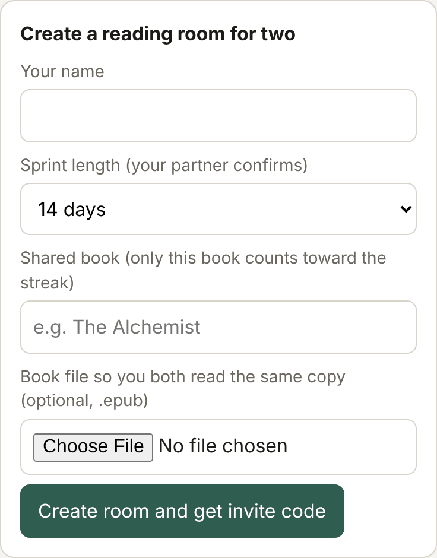 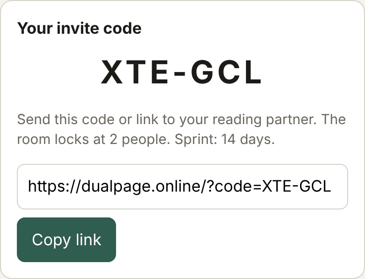

**The invited person**
1. Open dualpage.online, choose **Join with a code**, enter your name and the code.
2. Check the sprint length and tap **Accept**. The sprint starts now.

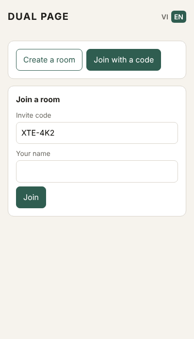 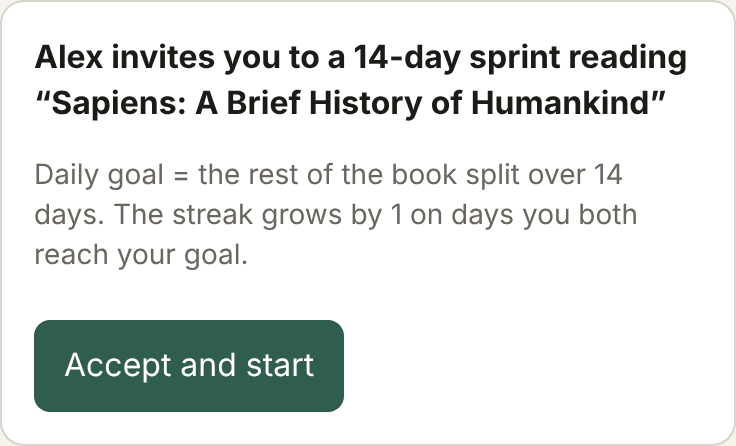

There are only 2 people per room. The website remembers your room in that browser. To open it elsewhere, use **your private link** at the bottom of the page (the one with `#t=`). Don't share that link.

---

## 2. Set up an XTeink (CrossPoint)

**You need:** an XTeink X4 or X4 Pro running **CrossPoint 2.0.0 or later**. Older versions have no Plugins menu; update the firmware first.

1. On dualpage.online, in **Your reader** → **XTeink**, tap **Download the XTeink plugin**.

   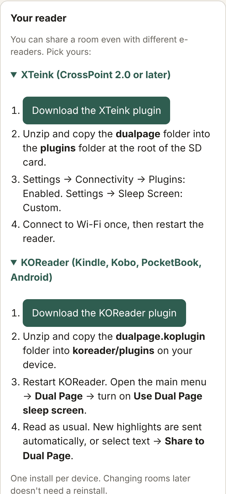

2. Unzip it. You get a `dualpage` folder.
3. Put the SD card in your computer and copy `dualpage` into the `plugins` folder at the root of the card, giving `/plugins/dualpage/`. Create `plugins` if it doesn't exist.
4. Put the card back. Go to **Settings → Connectivity → Plugins** and turn on **Enabled**.
5. Go to **Settings → Sleep Screen** and pick **Custom** so the sleep screen shows Dual Page.
6. Connect to Wi-Fi once, then restart the reader.
7. On the plugin's settings page, tap **Turn on highlight sharing**. This points the reader's KOSync highlight sync at Dual Page.

**Open Dual Page on the reader:** Home → Plugins → **Dual Page**.

The menu has 4 sections. Each title shows what's new, e.g. **Today · Sam nudged you to read!**

| Section | What's in it |
|---|---|
| **Today** | Reading streak, how much each of you read today, the nudge button, nudges you received |
| **Highlights** | What your partner shared, what you're sharing, pick another line to share |
| **Shared book** | Title, the file you're reading, download the shared book |
| **Sprint & extension** | Day number, days left, daily goal, propose or accept an extension |

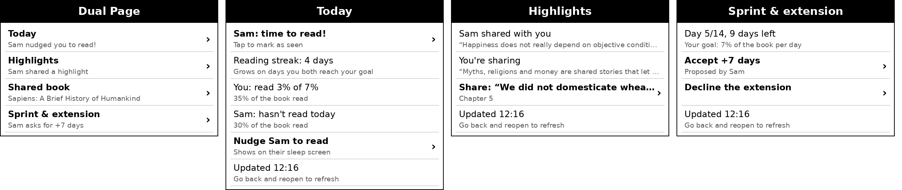

*Dual Page menu on the reader (illustration). Bold rows with › are buttons.*

---

## 3. Set up a Kindle, Kobo… (KOReader)

**You need:** **KOReader** installed. Kindles need a jailbreak to run KOReader. Kobo, PocketBook and Android install KOReader normally.

1. On dualpage.online, in **Your reader** → **KOReader**, tap **Download the KOReader plugin**.
2. Unzip it. You get a `dualpage.koplugin` folder.
3. Connect the device to your computer and copy that folder into KOReader's plugin folder:

   | Device | Copy into |
   |---|---|
   | Kindle | `koreader/plugins/` |
   | Kobo | `.adds/koreader/plugins/` (`.adds` may be hidden) |
   | PocketBook | `applications/koreader/plugins/` |
   | Android | `koreader/plugins/` in device storage |

4. Eject and **restart KOReader**.
5. Open KOReader's main menu (tap the top of the screen) → **Dual Page** → turn on **Use Dual Page sleep screen**.
6. Open **Dual Page → Open Dual Page** to see your room. It has the same 4 sections as on the XTeink.

**Kindle note:** the Dual Page sleep screen only shows when KOReader handles sleep. If you still see Amazon's screensaver, check KOReader's **Screen → Sleep screen** settings. Kindles with ads (Special Offers) may always show Amazon's ads.

To stop using the Dual Page sleep screen, untick **Use Dual Page sleep screen**. KOReader goes back to your previous sleep screen.

---

## 4. Reading every day

1. Open the **shared book** and read as usual. Only the shared book counts. Other books are fine, they just don't count.
2. If the room creator uploaded the epub, open the Dual Page menu on your reader → **Shared book** → **Download the shared book**. It's saved to a `DualPage` folder.
3. With Wi-Fi on, progress is sent automatically:
   - **XTeink:** after each reading session, when the reader sleeps.
   - **KOReader:** while reading (about every 10 minutes), when you close the book, and when the device sleeps. To send right away: **Dual Page → Send progress and refresh sleep screen**.
4. Put the reader to sleep to see the Dual Page screen: your shared streak, both people's progress, your partner's shared highlight, and any nudge.

| XTeink | Kindle (KOReader) |
|---|---|
| 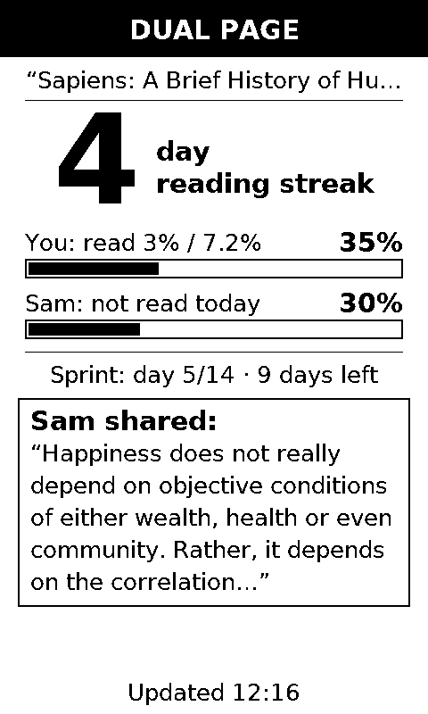 | 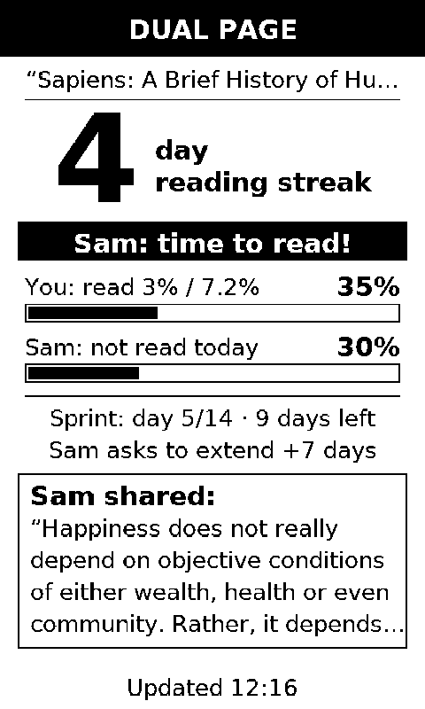 |

The website's **Today** card shows the same information:

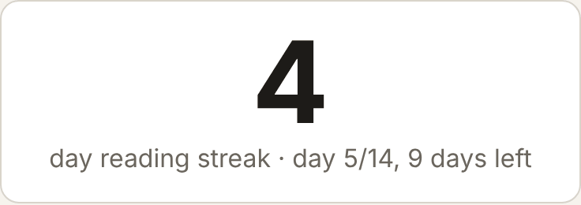 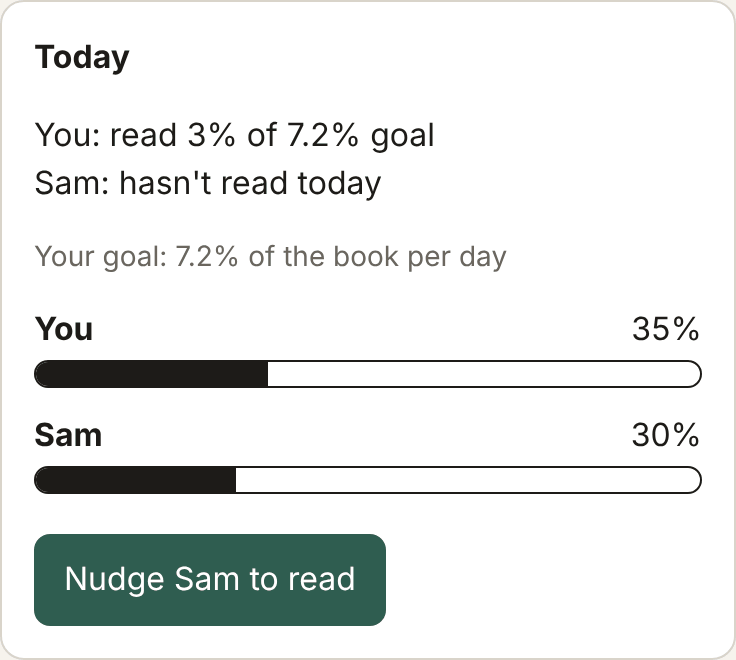

No Wi-Fi? No problem. The reader keeps the data and sends it when it's back online.

---

## 5. Sharing highlights

Every highlight you make in the shared book is sent to Dual Page. **Your newest highlight automatically appears on your partner's sleep screen.** Lines longer than 140 characters are shortened to fit.

To share a different line:
- **On the reader:** Dual Page menu → **Highlights** → a **Share: "…"** row.
- **On the website:** **Shared highlights** card → **share this one**.

  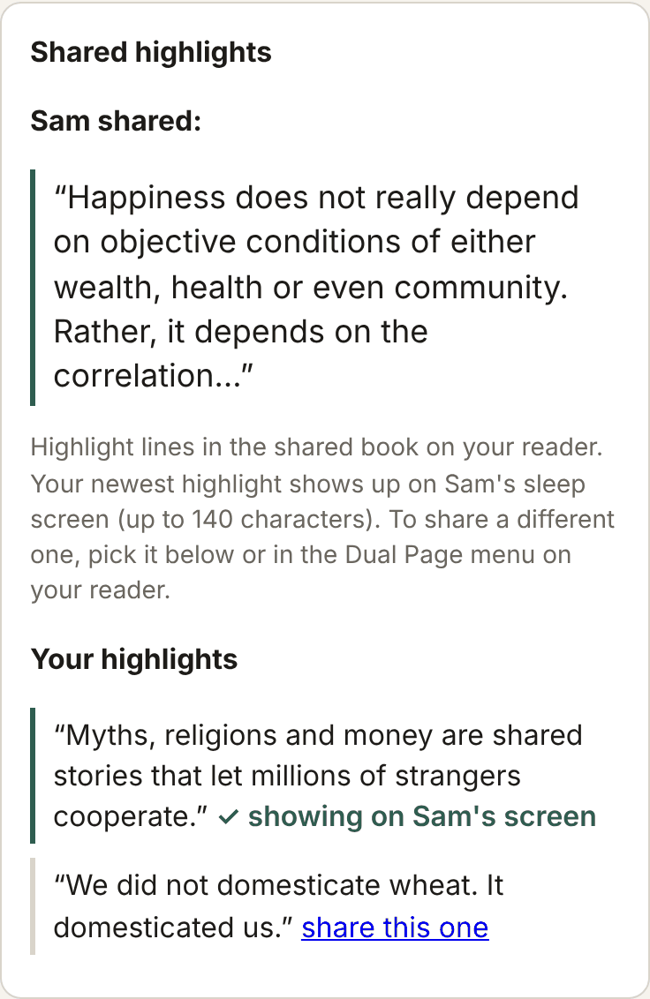

- **KOReader:** select text and tap **Share to Dual Page** in the highlight popup. It's shared right away, even if you don't save the highlight.

  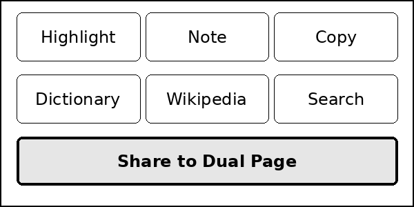

  *The Share to Dual Page button in KOReader's highlight popup (illustration).*

Your partner's sleep screen switches to the new line the next time their reader sleeps with Wi-Fi.

---

## 6. Nudges and sprint extensions

**Nudges**
- If your partner hasn't read today, the Dual Page menu and the website show **Nudge … to read**.
- The nudge appears on their sleep screen and in their menu.
- It disappears once they read more of the shared book, or when they tap **seen** on the reader or the website.

  

**Extending the sprint**
- Either person proposes **+3 days** or **+7 days** on the reader or the website.
- The other taps **Accept** or **Decline**. The sprint is only extended if both agree.

  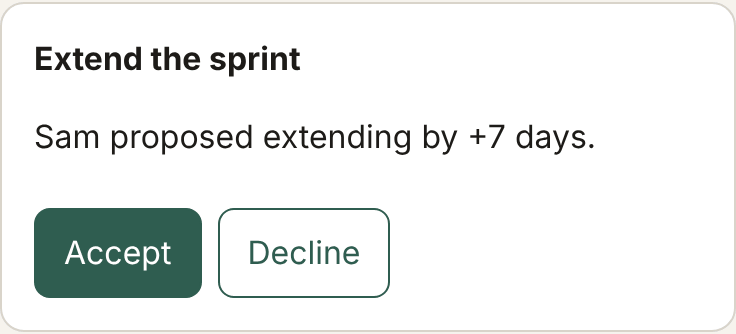

**End of the sprint:** the reader and the website show a **Recap** with the days you both hit your goal, how much of the book each person read, and minutes read.

---

## 7. How progress and the streak are counted

- **Progress** is the furthest point you've reached in the shared book, e.g. 35%. Going back to reread doesn't lower it. Flipping back and forth over the same part doesn't add to it.
- **Read today** is today's furthest point minus the furthest point before today.
- **Daily goal** is the part of the book left when the sprint starts, divided by the number of days. Starting at 0% with a 14-day sprint, that's about 7% a day.
- The **shared streak** grows by 1 on each day **both** of you reach your goal. Days follow each person's own time zone.
- Progress is based only on **your position in the book**, not on page turns. Jumping straight to the end currently counts as reading that far, so play fair with each other.

---

## 8. FAQ and troubleshooting

**Do I reinstall the plugin when I change rooms?**
No. Install once per device. When you create or join a new room **in the same browser** you downloaded the plugin from, the reader switches over automatically.

**My XTeink has no Plugins menu.**
It's running an older CrossPoint. Update to 2.0.0 or later.

**The sleep screen doesn't change.**
- XTeink: check Sleep Screen = **Custom** and that Wi-Fi is available when the reader sleeps.
- KOReader: check **Use Dual Page sleep screen** is on. The image updates when online, so you see the most recent update.

**My progress doesn't go up.**
You may be reading a different file than the shared book. The **Shared book** section shows **Your file: …** so you can check. The surest way is to download the shared book from the Dual Page menu.

**The menu says "This reader isn't in a room".**
Open dualpage.online in the browser you downloaded the plugin from, create or join a room, then reopen the menu.

**Is the plugin safe?**
It only sends the book's file name, your reading position, reading time and your highlights from the shared book to dualpage.online. `config.json` (XTeink) and `dualpage_config.lua` (KOReader) hold your device's private code; don't share them.
