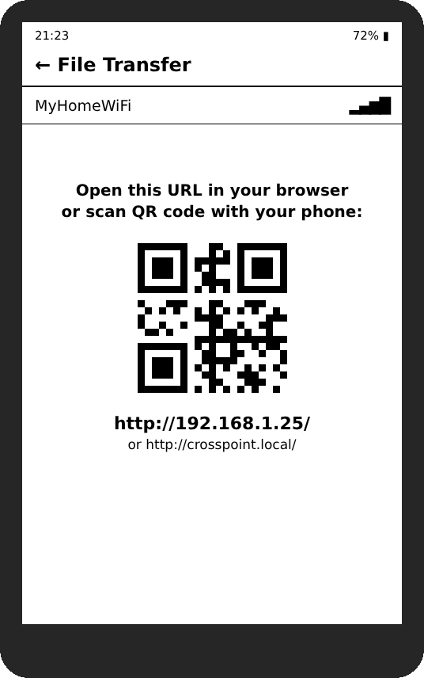
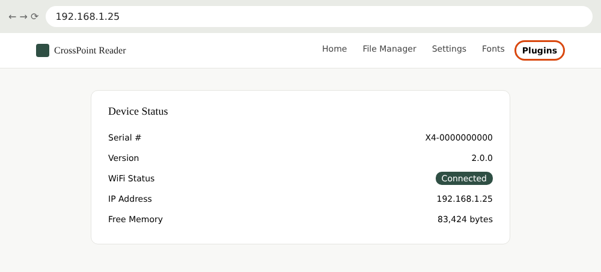
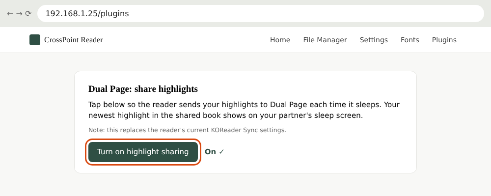
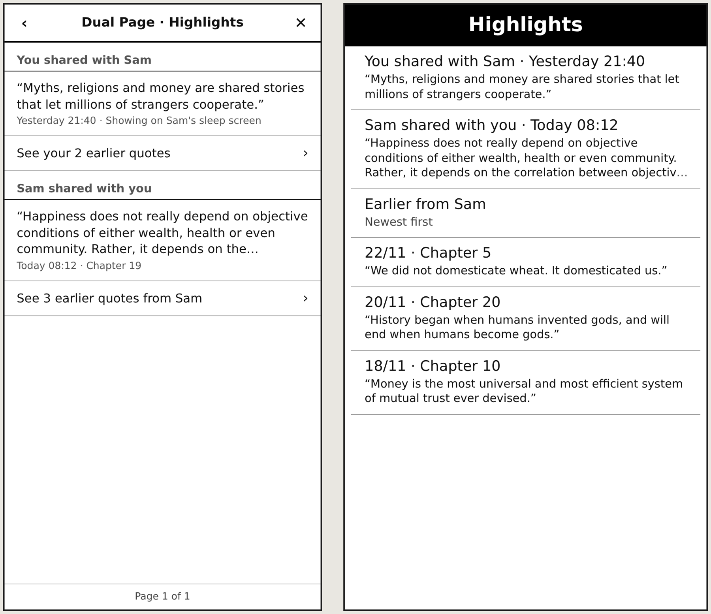
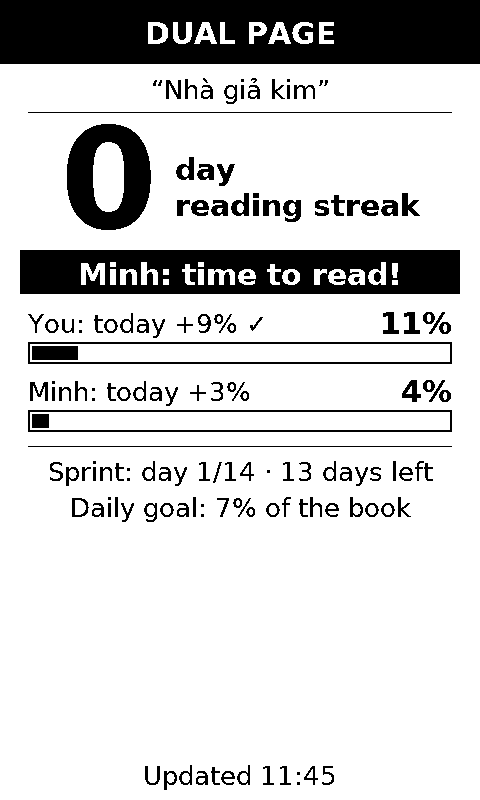
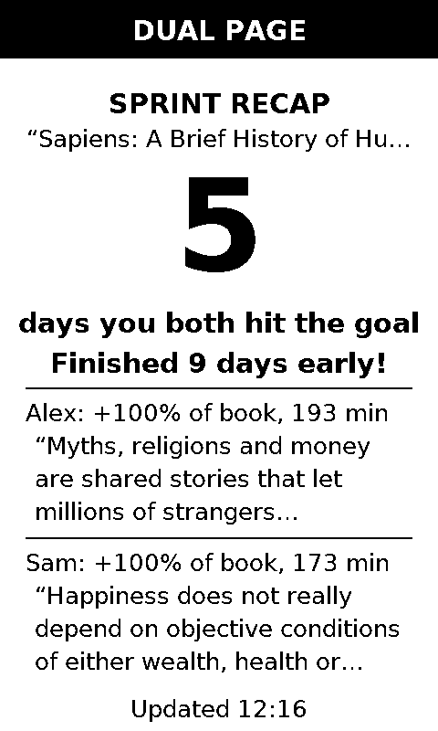

# Dual Page user guide

Dual Page lets two people read the same book together, each on their own e-reader. You can even use **different devices**: one person on an XTeink, the other on a Kindle or Kobo running KOReader, in the same room.

*Tiếng Việt: [HUONG-DAN-SU-DUNG.md](HUONG-DAN-SU-DUNG.md)*

Contents:
1. [Create a room and invite your partner](#1-create-a-room-and-invite-your-partner)
2. [Set up an XTeink (CrossPoint)](#2-set-up-an-xteink-crosspoint)
3. [Set up a Kindle, Kobo… (KOReader)](#3-set-up-a-kindle-kobo-koreader)
4. [Reading every day](#4-reading-every-day)
5. [Sharing highlights](#5-sharing-highlights)
6. [Nudges and sprint extensions](#6-nudges-and-sprint-extensions)
7. Turn on highlight sharing (once; you need a computer or phone on the same Wi-Fi):
   1. On the reader, open **File Transfer** and connect to Wi-Fi. The reader shows an address, e.g. `http://192.168.1.25/` or `http://crosspoint.local/`.

      

   2. On a computer on **the same Wi-Fi**, open a browser and type that address. The reader's page opens. Click **Plugins** in the top bar.

      

   3. On the **Dual Page: share highlights** card, click **Turn on highlight sharing**. When it shows **On ✓**, you're done. This points the reader's KOSync highlight sync at Dual Page.

      

   4. On the reader, exit **File Transfer**.

   *Illustrations only; your reader's address will differ.*
8. [FAQ and troubleshooting](#8-faq-and-troubleshooting)

---

## 1. Create a room and invite your partner

Do this on your phone or computer at **https://dualpage.online**. The page follows your browser's language; switch with **VI | EN** at the top right. Each person's choice also sets the language of their own sleep screen and device menu, so partners can use different languages.

**The person creating the room**
1. Enter your name.
2. Enter the **shared book's title**. If you have the epub, choose the file to upload it (up to 24 MB) so your partner downloads the exact same copy.
3. Pick the sprint length: 7, 14, 21, 30 days or a custom number.
4. Tap **Create room**. You get an invite code like `XTE-ABC`. Send it to your partner.

 

**The invited person**
1. Open dualpage.online, choose **Join with a code**, enter your name and the code.
2. Check the sprint length and tap **Accept**. The sprint starts now.

 

There are only 2 people per room. No account needed: the website remembers your room with a private code saved in your browser. To open it elsewhere, use **your private link** at the bottom of the page (the one with `#t=`). Don't share that link.

**Leaving a room:** tap **Leave room** at the top of the page and confirm. Your partner is told on the website, their sleep screen and their reader menu, with a summary of the streak and progress. The room closes, the old invite code stops working and the shared book file is deleted. Then create or join a new room and your reader follows. Before anyone joins, the button reads **Cancel room**.

---

## 2. Set up an XTeink (CrossPoint)

**You need:** an XTeink X4 or X4 Pro running **CrossPoint 2.0.0 or later**. Older versions have no Plugins menu; update the firmware first.

1. On dualpage.online, in **Your reader** → **XTeink**, tap **Download the XTeink plugin**.

   

2. Unzip it. You get a `dualpage` folder.
3. Put the SD card in your computer and copy `dualpage` into the `plugins` folder at the root of the card, giving `/plugins/dualpage/`. Create `plugins` if it doesn't exist.
4. Put the card back. Go to **Settings → Connectivity → Plugins** and turn on **Enabled**.
5. Go to **Settings → Sleep Screen** and pick **Custom** so the sleep screen shows Dual Page.
6. Connect to Wi-Fi once, then restart the reader.
7. On the plugin's settings page, tap **Turn on highlight sharing**. This points the reader's KOSync highlight sync at Dual Page.

   **Or do it on the device:** open Dual Page → **Highlights**. Until sharing is on, it shows your device's 6-character code and the values to enter. Go to **Settings → CrossPoint Sync** and set:
   - Server Type: **KoSync**
   - Sync Server URL: **https://dualpage.online/kosync**
   - Username: **the 6-character code** (any case)
   - Password: **dualpage**
   - Document Matching: **Binary**
   - Sync Clippings: **On**

   The setup rows hide after the first sync.

**Open Dual Page on the reader:** Home → Plugins → **Dual Page**.

The menu has 4 sections. Each title shows what's new, e.g. **Today · Sam nudged you to read!**

| Section | What's in it |
|---|---|
| **Today** | Reading streak, how much each of you read today, the nudge button, nudges you received |
| **Highlights** | What you're sharing, what your partner is sharing, and your partner's earlier quotes |
| **Shared book** | Title, the file you're reading, download the shared book |
| **Sprint & extension** | Day number, days left, daily goal, propose or accept an extension |

*Dual Page menu on the reader (illustration). Bold rows with › are buttons.*

---

> **Which rows do something?** In the Dual Page menu, rows starting with **»** are buttons (nudge, extend, download the book). Other rows are just information. On XTeink, pressing an info row shows "Download complete" and changes nothing.

## 3. Set up a Kindle, Kobo… (KOReader)

**You need:** **KOReader** installed. Kindles need a jailbreak to run KOReader. Kobo, PocketBook and Android install KOReader normally.

1. On dualpage.online, in **Your reader** → **KOReader**, tap **Download the KOReader plugin**.
2. Unzip it. You get a `dualpage.koplugin` folder.
3. Connect the device to your computer and copy that folder into KOReader's plugin folder:

   | Device | Copy into |
   |---|---|
   | Kindle | `koreader/plugins/` |
   | Kobo | `.adds/koreader/plugins/` (`.adds` may be hidden) |
   | PocketBook | `applications/koreader/plugins/` |
   | Android | `koreader/plugins/` in device storage |

4. Eject and **restart KOReader**.
5. Open KOReader's main menu (tap the top of the screen) → **Dual Page** → turn on **Use Dual Page sleep screen**.
6. Open **Dual Page → Open Dual Page** to see your room. It has the same 4 sections as on the XTeink.

**The KOReader plugin updates itself.** When there's a new version, it downloads it when you open Dual Page (or every few hours on Wi-Fi) and asks to **restart KOReader**. Say yes; no copying files again.

**Open Dual Page with a gesture (optional):** KOReader menu → **gear → Taps and gestures → Gesture manager** → pick a gesture, e.g. **Long-press on corner → Bottom right** → **General** → scroll to the end and tick **Dual Page**. KOReader keeps separate gestures for reading and for the file browser; set it in both if you like.

**Kindle note:** the Dual Page sleep screen only shows when KOReader handles sleep. If you still see Amazon's screensaver, check KOReader's **Screen → Sleep screen** settings. Turning on the Dual Page sleep screen also hides KOReader's "Sleeping" message; if it still shows, untick the message option in **Screen → Sleep screen**.

**Kindles with ads (Special Offers) always show Amazon's ad when asleep**: KOReader turns its own sleep screen off on these devices. Two ways around it:
- **Remove the ads** on Amazon: **Manage Content & Devices → Devices → your Kindle → Special Offers → Remove** (usually a one-time fee of about 20 USD).
- **Turn them off until the next reboot:** in KOReader open **Tools → Terminal emulator**, type `lipc-set-prop com.lab126.blanket unload ad_screensaver` (one line), press Enter, then restart KOReader. Repeat after every Kindle reboot.

Progress, highlights and nudges still work with ads on.

To stop using the Dual Page sleep screen, untick **Use Dual Page sleep screen**. KOReader goes back to your previous sleep screen.

---

## 4. Reading every day

1. Open the **shared book** and read as usual. Only the shared book counts. Other books are fine, they just don't count.
2. If the room creator uploaded the epub, open the Dual Page menu on your reader → **Shared book** → **» Download "…"**:
   - **XTeink:** it's saved to a `DualPage` folder. The first time, open it from **Home → File browser → DualPage** (the firmware can't put new downloads at the top of the Library yet). Once you've read it, it stays in Recent and Continue reading.
   - **KOReader:** it's saved straight into your books folder (Kindle: `documents`) and **opens right away**. Tapping download again when you already have it just opens it.
3. Progress is sent **automatically** on Wi-Fi, nothing to tap:
   - **XTeink:** when you leave the book and when the reader sleeps.
   - **KOReader:** about 15 seconds after a page turn, when you close the book, and when the device sleeps.
4. Put the reader to sleep to see the Dual Page screen: your shared streak, how much each of you read today (✓ when the goal is met), total % of the book, the daily goal, your partner's shared highlight and any nudge. Kindle and XTeink use the same layout. A sleeping reader shows your partner's new progress the next time it sleeps with Wi-Fi.

| XTeink | Kindle (KOReader) |
|---|---|
|  |  |

The website's **Today** card shows the same information:

 

No Wi-Fi? No problem. The reader keeps the data and sends it when it's back online.

---

## 5. Sharing highlights

Highlights in the shared book are sent to Dual Page. **Your newest highlight automatically appears on your partner's sleep screen.** Quotes up to **300 characters** (about 2–3 sentences) show in full; longer ones are shortened. Long quotes use smaller text so they fit. Each reader keeps only their **3 latest highlights**; older ones are dropped automatically. Quotes you **shared** are kept separately: Dual Page saves each reader's **10 latest shared quotes** so you can both read them again under **Highlights**.

### XTeink

**Turn it on once:** do step 7 of the XTeink setup (the **Turn on highlight sharing** button on the reader's web page, or enter the values shown under Dual Page → **Highlights** in **Settings → CrossPoint Sync**).

**Highlight:**
- **X4:** press **Confirm** (2nd button from the left on the front row) to open the in-book menu → **Create Clipping**. Use Left/Right to pick the first word, press Confirm, pick the last word, press Confirm again.
- **X4 Pro:** press and hold on the text to start selecting.

**Send:** XTeink only sends highlights when you sync. After highlighting, open the in-book menu → **Sync Progress**. It shows "Syncing Clippings..." and finishes. Syncing also sends your reading progress.

**Faster: put sync on a button (one-time setup):**
- **X4 Pro:** **Settings → Controls → Home Button Gestures**, set **Double Tap = CrossPoint Sync**. Double-tap Home while reading.
- **X4:** **Settings → Controls → Long-Press Menu**, choose **CrossPoint Sync**. Long-press Confirm while reading.
- Keep **Settings → CrossPoint Sync → Sync Behavior = Smart Sync** (the default) so it sends without asking.

### KOReader (Kindle, Kobo…)

Highlight as usual; it's sent automatically when Wi-Fi is on. To share a line right away, select text and tap **Share to Dual Page** in the highlight popup. It's shared immediately, even if you don't save the highlight.

  

  *The Share to Dual Page button in KOReader's highlight popup (illustration).*

### Read shared quotes again

Open the Dual Page menu → **Highlights**. Once a quote is shared, that's it: there's no re-sharing.

- **Kindle/Kobo (KOReader):** two parts, **You shared with …** on top and **… shared with you** below. Each shows the newest quote and a **See N earlier quotes ›** row that opens the older ones. Tap any quote to read it in full.
- **XTeink:** one page. Your current quote first, then your partner's, then the **3 latest** quotes your partner shared before. Each quote shows up to 3 lines.

  

  *Highlights on Kindle (left) and XTeink (right), illustration.*

**To share a different line:** highlight a new one in the shared book (on XTeink, remember **Sync Progress**), or on the website open the **Shared highlights** card and tap **share this one**.

  

### When your partner sees it

- **Kindle/Kobo (KOReader):** while KOReader is open it checks every minute and downloads a new sleep screen if anything changed. A sleeping device can't update (Wi-Fi is off); the new line shows the next time it sleeps.
- **XTeink:** the sleep screen updates the next time the reader sleeps with Wi-Fi.

---

## 6. Nudges and sprint extensions

**Nudges**
- If your partner hasn't read today, the Dual Page menu and the website show **Nudge … to read**.
- The nudge appears on their sleep screen and in their menu.
- It disappears once they read more of the shared book, or when they tap **seen** on the reader or the website.

  

**Extending the sprint**
- Either person proposes an extension of **any number of days** (1–30) on the reader or the website.
  - Website: type the number into "Days (1–30)" and press **Propose**.
  - XTeink: open Plugins → Dual Page, tap the **magnifier** in the title bar (no touch screen: select the top row and press Left), type the number (e.g. `5`), then pick **» Propose +5 days**. The "Extend the sprint" row is only a reminder; pressing it doesn't open a keyboard. Needs plugin 0.3.1 or later (download the plugin again from the website once).
  - KOReader: pick **» Propose an extension…** and type the number.
- The other taps **Accept** or **Decline**. The sprint is only extended if both agree.

  

**End of the sprint:** the reader and the website show a **Recap** with the days you both hit your goal, how much of the book each person read, and minutes read. The shared book file is kept 7 more days, then deleted from the server (copies on your readers stay). Rooms whose sprint never started lose their book file after 30 days.

---

## 7. How progress and the streak are counted

- **Progress** is your **latest position** in the shared book, e.g. 35%. If you accidentally jump to the end your partner sees that, but going back brings it back too.
- **Today** (e.g. "today +9%") is your current position minus where the day started: yesterday's last position, or today's lowest point if lower. However much you read shows up, with ✓ once you reach the goal.
- **Daily goal** is the part of the book left when the sprint starts, divided by the number of days. Starting at 0% with a 14-day sprint, that's about 7% a day.
- The **shared streak** grows by 1 on each day **both** of you reach your goal. Days follow each person's own time zone.
- Progress is based only on **your position in the book**, not on page turns. Example: at 10% you slip to 96%, your partner sees "today +86%"; go back to 10% and really read to 20%, and it becomes "today +10%".

---

## 8. FAQ and troubleshooting

**Do I reinstall the plugin when I change rooms or when there's a new version?**
No. Install once per device. When you create or join a new room **in the same browser** you downloaded the plugin from, the reader switches over automatically. The KOReader plugin updates itself. The XTeink plugin rarely needs updates because the menu, text and sleep screen all come from the server.

**I deleted the shared book and downloaded it again.**
Your progress is kept on the server, but the reader opens the book from the start.
- **KOReader:** when the book opens, the plugin asks "You got to …%. Continue from there?". Tap **Continue**.
- **XTeink:** open the book, then the in-book menu → **Sync Progress**. It jumps to where Dual Page last saw you (needs highlight sharing turned on during setup). Sync before leaving the book: leaving at 0% records 0%.

**I can't find the downloaded book on my Kindle.**
It's in `documents`. An older plugin may have saved it in the Kindle's top folder or in a `DualPage` folder outside `documents`: go up to the top folder in KOReader's file browser. Tapping download again in the Dual Page menu also opens the old copy.

**My XTeink has no Plugins menu.**
It's running an older CrossPoint. Update to 2.0.0 or later.

**The sleep screen doesn't change.**
- XTeink: check Sleep Screen = **Custom** and that Wi-Fi is available when the reader sleeps.
- KOReader: check **Use Dual Page sleep screen** is on. The image updates when online, so you see the most recent update.

**My progress doesn't go up.**
You may be reading a different file than the shared book. The **Shared book** section shows **Your file: …** so you can check. The surest way is to download the shared book from the Dual Page menu.

**The menu says "This reader isn't in a room".**
Open dualpage.online in the browser you downloaded the plugin from, create or join a room, then reopen the menu.

**Is the plugin safe?**
It only sends the book's file name, your reading position, reading time and your highlights from the shared book to dualpage.online. `config.json` (XTeink) and `dualpage_config.lua` (KOReader) hold your device's private code; don't share them.
